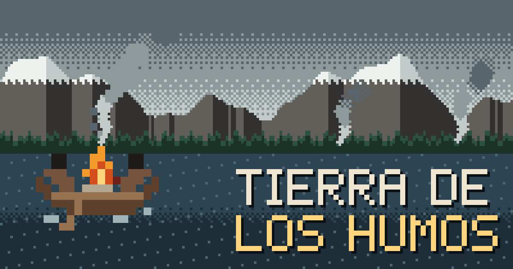
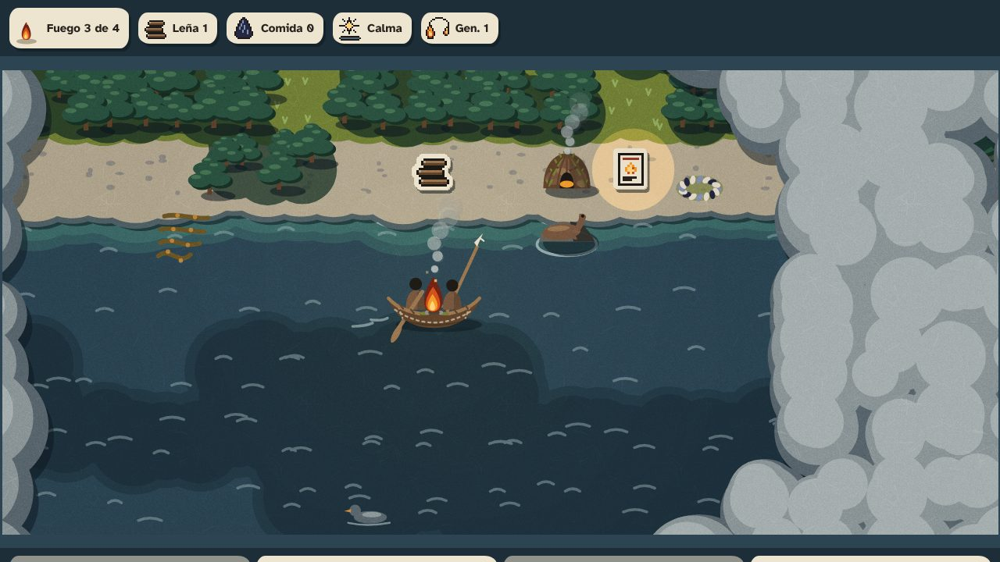
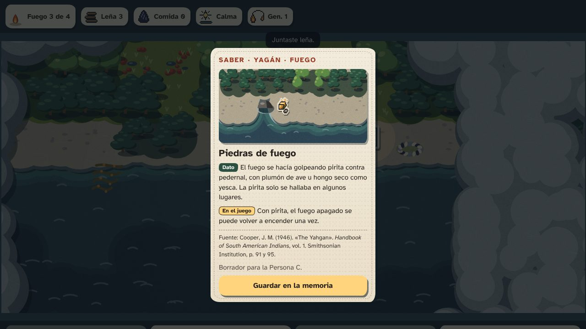
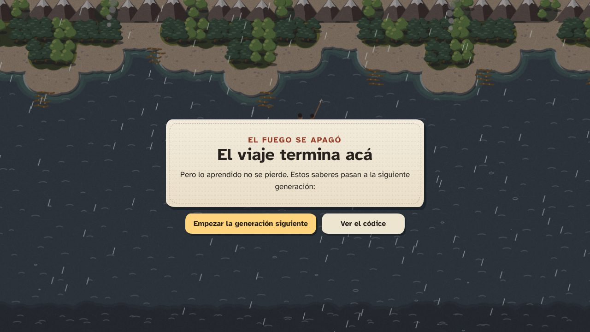

# Tierra de los Humos — roguelike fueguino

Videojuego web de tipo roguelike sobre los saberes de los pueblos originarios de Tierra del Fuego. Lo desarrolla el equipo **Tierra de los Humos** para la hackatón [SoberaníaTech 2026](https://soberaniatech.com.ar/), organizada por la Agencia de Innovación de Tierra del Fuego.

> 🚧 **En desarrollo** (9 al 18 de noviembre de 2026). Ya están el estilo visual, el motor de dibujo, el sonido y una maqueta navegable de todas las pantallas; el código del juego se suma durante la hackatón.

**Jugalo:** [facunique.github.io/Tierra-de-los-Humos](https://facunique.github.io/Tierra-de-los-Humos/) (el viaje completo, en el celular o en la compu; también abre con doble clic en `index.html`, sin internet) · **Video:** ✏️ *[enlace]* · **Presentación:** [`presentacion/`](presentacion/index.html) ([PDF](presentacion/pitch.pdf))

## Eje

**04 · Memoria, Cultura e Innovación Comunitaria**

## Problema

Los saberes de los pueblos Selk'nam, Haush y Yagán sobre la vida en el territorio fueguino (navegar los canales, recolectar, cuidar el fuego, adaptarse al clima) son poco conocidos por jóvenes y escuelas. Cuando aparecen, suelen contarse en pasado, como si esos pueblos ya no existieran.

## Solución propuesta

Un juego web que se juega desde el navegador, también en el celular. Cada partida es un viaje en el que el fuego es tu vida: se gasta con el frío y el viento, y se mantiene con lo que el territorio ofrece. Lo que se aprende en un viaje pasa a la siguiente generación como **cartas de saber**, cada una con su fuente citada. La mecánica del roguelike (morir, volver a empezar, avanzar) representa así la **transmisión de la memoria**.

Tres ideas lo sostienen:

1. **El fuego es la vida.** Las familias yaganes llevaban el fuego encendido en el medio de la canoa (Cooper, 1946, p. 88 y 91). En el juego, ese fuego es la barra de vida.
2. **Morir es transmitir.** Cuando el fuego se apaga, los saberes encontrados pasan a la siguiente generación del mismo pueblo.
3. **Cada saber tiene fuente, y los pueblos están vivos.** Nada inventado presentado como real: cada carta separa el *dato* del *recurso de juego* y cita su fuente con página. Todo se cuenta en presente, con consulta a la comunidad.

El concepto completo está en [docs/01-concepto.md](docs/01-concepto.md).

### Para todos, también en el aula

- **Accesible:** un narrador cuenta el viaje en voz alta para jugar sin ver la pantalla, las cartas se escuchan en voz alta, hay modo alto contraste, tipografía para baja visión, colores probados para daltonismo y subtítulos para cada sonido.
- **El territorio se siente:** la luz del juego es la de Ushuaia en ese momento (de día, al atardecer o de noche, y en su estación), y el sonido cambia según el lugar: el bosque, la playa y el canal abierto suenan distinto.
- **Algo para llevarse:** al terminar, una postal del viaje con el recorrido y los saberes aprendidos.
- **En la escuela:** una [guía para docentes](escuelas/README.md) con una actividad por carta, y una [versión de mesa](mesa/README.md) para jugar sin pantallas.

| El viaje | Una carta de saber | Fin del viaje y herencia |
|---|---|---|
|  |  |  |

*Capturas de la maqueta de pantallas. Se reemplazan por capturas del juego antes del avance del 16/11.*

## Documentación

| Documento | Contenido |
|---|---|
| [00 · Guía de la hackatón](docs/00-guia-hackathon.md) | Bases, fechas, criterios de evaluación, cuidados culturales y plan por fases |
| [01 · Concepto](docs/01-concepto.md) | Premisa, pueblos (Yagán primero), bucle central, transmisión entre partidas, tono y aporte al eje |
| [04 · Dirección de arte y sonido](docs/04-direccion-de-arte.md) | El estilo Corteza: principios, motor de dibujo, cartas, paleta, sonido y accesibilidad |
| [05 · Rigor histórico del arte](docs/05-rigor-historico.md) | Cada elemento dibujado contrastado con las fuentes etnográficas, con página |

Arte y sonido:

| Recurso | Contenido |
|---|---|
| [Estilo Corteza](arte/corteza/index.html) | El estilo elegido, en vivo: tocá el agua y la canoa rema (abrir el archivo en el navegador) |
| [Mapa de territorios](arte/mapa/index.html) | Tierra del Fuego y los canales, con los territorios ancestrales de cada pueblo y sus fuentes |
| [Pantallas del juego](arte/pantallas/index.html) | Maqueta navegable de todo el recorrido: título, viaje, cartas, fin del viaje, códice y cierre en presente |
| [`arte/`](arte/README.md) | Motor de dibujo, paleta, pegatinas pixel, logo y tipografía. Todo propio |
| [Cartas para imprimir](arte/cartas/cartas-para-imprimir.pdf) | Cartas de saber en A4, doble faz, para la demo |
| [Versión de mesa](mesa/README.md) | El juego en papel, para escuelas sin pantallas: tablero A3, fichas, reglas de una página y Libro de la familia |
| [Editor de saberes](herramientas/editor-de-saberes.html) | Para que el equipo y la comunidad escriban o corrijan una carta sin programar, con relato oral como fuente, solo con permiso ([cómo funciona](herramientas/README.md)) |
| [Guía para docentes](escuelas/README.md) | Cómo usar el juego en clase, cuidados, una actividad por carta, la tabla de luz de Ushuaia y una hoja para fotocopiar ([PDF](escuelas/guia-docente-A4.pdf)) |
| [Stand de la demo](stand/README.md) | Vidriera que se reproduce sola, cartel A3 con QR y códigos QR |
| [Propuestas de estilo](arte/propuestas/index.html) | Las tres propuestas que votó el equipo (registro) |
| [`sonido/`](sonido/README.md) | Sonido ambiente que cambia según el lugar, efectos y lectura de las cartas en voz alta. Todo generado por código, con demo |

Trabajo interno del equipo:

| Documento | Contenido |
|---|---|
| [Memoria del proyecto](equipo/memory.md) | Decisiones tomadas, estado actual, pendientes y glosario |
| [Comunicaciones con comunidades](equipo/comunicaciones.md) | Registro de la consulta a comunidades y personas, con permisos y correcciones |
| [Comunicación](equipo/comunicacion.md) | Plan del video, el pitch, el avance del 16/11 y la demo del 20/11 |
| [Storyboard del video](equipo/video/README.md) | Un cuadro por tramo, con la voz y el sonido |
| [AGENTS.md](AGENTS.md) | Reglas de trabajo para asistentes de IA (y para el equipo) |

## Cómo jugar

**Objetivo:** llegar al destino con el fuego encendido. Si el fuego se apaga, el viaje termina y lo aprendido pasa a la siguiente generación.

| Qué | En el celular | Con teclado |
|---|---|---|
| Remar | Tocar el agua: la canoa rema hasta ahí. O las flechas de la pantalla | Flechas o <kbd>W</kbd> <kbd>A</kbd> <kbd>S</kbd> <kbd>D</kbd> |
| Juntar (leña, comida, pirita, saberes) | Botón «Juntar», o tocar la pegatina | <kbd>Enter</kbd> o <kbd>J</kbd> |
| Avivar el fuego con leña | Botón «Avivar el fuego» | <kbd>F</kbd> |
| Amarrar en el cachiyuyo y acampar | Botón «Amarrar y acampar» | <kbd>M</kbd> |
| Describir lo que rodea a la canoa (con el narrador) | Botón «Describir alrededor» | <kbd>N</kbd> |
| Pausa | Botón «Pausa» | <kbd>Esc</kbd> |

- **El fuego** se gasta al remar, y más con viento en el canal hondo, con lluvia o de noche. Cerca de una choza se gasta menos. Siempre se muestra su número («Fuego 3 de 4»).
- **Lo que tiene borde de papel (las pegatinas) se puede juntar.** El resto es paisaje.
- **El humo** cubre lo que todavía no exploraste.
- **Al remar tocando lejos**, la canoa se frena sola si el fuego queda en 1 o cae la noche, para que haya tiempo de avivarlo o de acampar.
- **La herencia** se guarda en el dispositivo: al volver a abrir el juego, la familia sigue en la generación en que iba.
- **El códice** junta todas las cartas de saber, separadas por pueblo, y se puede recorrer sin jugar. «Empezar de cero» borra la memoria de la familia en ese dispositivo.
- **Opciones** (en la pantalla de título): sonido con subtítulos, narrador para jugar sin ver, alto contraste y luz real de Ushuaia.

✏️ *Completar con los números finales del juego (Personas A y B).*

## Tecnologías

- **Juego web** en HTML, CSS y JavaScript, dibujado en Canvas 2D. **Sin build y sin librerías externas:** cada archivo se carga con `<script>`, así que el juego también se abre con doble clic en `index.html`, sin internet.
- **Publicación:** GitHub Pages, desde la rama `main` (carpeta raíz), en [facunique.github.io/Tierra-de-los-Humos](https://facunique.github.io/Tierra-de-los-Humos/). El archivo `.nojekyll` evita que GitHub procese el sitio con Jekyll.
- **Estructura:** el núcleo (`juego/nucleo/`) tiene solo las reglas del viaje, sin pantalla, y se prueba con Node. La interfaz (`juego/interfaz/`) dibuja con el motor Corteza y muestra lo que el núcleo cuenta que pasó. Todo se une en `index.html`.
- **Datos:** las cartas de saber (`datos/saberes.js`) y lo que hay en el territorio, las especies y el destino (`juego/nucleo/territorio/`) están en archivos JavaScript con su fuente citada, y se editan sin programar. Lo que se hereda entre partidas se guarda en el navegador (`localStorage`): solo los identificadores de las cartas, con número de versión (`juego/interfaz/herencia.js`).
- **Pruebas:** con el comando `node --test`, que ya viene con Node.js.
- **Arte:** motor de dibujo propio, «Corteza» (`arte/corteza/corteza.js`), y pegatinas pixel definidas como texto (`arte/fuente/arte.js`).
- **Sonido:** sintetizado con Web Audio (`sonido/ambiente.js`), sin archivos de audio. Las cartas se leen con la voz del dispositivo (Web Speech, `sonido/voz.js`).
- **Luz real:** la posición del sol en Ushuaia se calcula en el navegador, sin internet, con el algoritmo de la [NOAA](https://gml.noaa.gov/grad/solcalc/calcdetails.html) (`arte/corteza/luz-real.js`).
- **Sin internet:** todo, tipografía incluida, se sirve desde el repositorio.
- **Herramientas de apoyo** (solo para regenerar imágenes): Node.js y Playwright.

## Fuentes

Las referencias completas, sus páginas y los límites de cada uso están en [`docs/03-contenido-cultural.md`](docs/03-contenido-cultural.md). Los nombres de lugares se registran en [`docs/06-toponimia.md`](docs/06-toponimia.md), con el criterio **Onashaga — Canal Beagle**.

### Fuentes escritas

- **Vargas Filgueira, Víctor (2019). *Mi sangre yagán (ahua saapa yagan)*.** Primera edición digital. Editora Cultural Tierra del Fuego. Notas de lectura aportadas para la investigación: ballena varada (pp. 16–17), corteza (pp. 23 y 31–32), mujeres remando (p. 33), enseñanza y decisiones compartidas (pp. 39 y 46), reservas de invierno (pp. 53–54), encendido del fuego (p. 66) y topónimos (notas de pp. 86–88). Páginas del visor del PDF de 90 páginas; el asistente no consultó el ejemplar completo.
- **Cooper, J. M. (1946). «The Yahgan».** En J. H. Steward (ed.), *Handbook of South American Indians*, vol. 1: *The Marginal Tribes*, pp. 81–106. Smithsonian Institution, Bureau of American Ethnology, Bulletin 143. Referencias registradas por el equipo: territorio y clima (pp. 81–82), alimentos (p. 84), viviendas (pp. 85–86), canoa y corteza (pp. 88–89), fuego (p. 91), desplazamientos (pp. 94–95), tareas (p. 96) y encuentros por varamientos (p. 99). Para el mapa también se utilizan pp. 107–108 de «The Ona», en el mismo volumen. La mención de Lothrop (1928), p. 32, es una cita indirecta mediante Cooper, p. 84.
- **Bird, J. (1946). «The Archeology of Patagonia».** En el mismo *Handbook*, vol. 1, pp. 17–24. Smithsonian Institution, Bureau of American Ethnology, Bulletin 143. Conchales del canal Beagle: pp. 20–21.
- **Bird, J. (1946). «The Alacaluf».** En el mismo *Handbook*, vol. 1, pp. 55–79. Smithsonian Institution, Bureau of American Ethnology, Bulletin 143. Territorio Kawésqar: p. 55; recolección de leña entre los Kawésqar: p. 70. Esta última referencia no se atribuye como práctica yagán.
- **Spears, J. R. (1895). *The Gold Diggings of Cape Horn*.** Nueva York: Putnam. Testimonio de época registrado por el equipo como referencia del arte: canoa y fogón (pp. 56–57 y 64), pesca (pp. 60–61) y turbales de la Isla de los Estados (p. 149).

### Consulta a la comunidad

**Víctor Vargas Filgueira, referente de la comunidad yagán:** entrevista presencial del **13/11/2026, a las 11:00**, en el Museo del Fin del Mundo, Ushuaia. Nombre y atribución fiel de su testimonio autorizados verbalmente, sin restricción de medios. El permiso para citas textuales y las preguntas sobre representación, nombres y alcance de la participación comunitaria siguen abiertos en [`equipo/comunicaciones.md`](equipo/comunicaciones.md). La entrevista se registra por separado del libro y no se presenta como validación comunitaria de todo el juego.

### Referencias pendientes

🔍 Goodall, los pasajes de museos y la referencia botánica de Multequina requieren completar o verificar edición, año y localización. Gusinde, Chapman, Calderón y Zárraga, Lothrop, Orquera y Piana, y Bridges conservan sus pendientes de consulta o ficha bibliográfica en [`docs/03-contenido-cultural.md`](docs/03-contenido-cultural.md#referencias-pendientes-de-completar-o-consultar). También faltan fuentes de especies, cartografía y páginas del epílogo de Vargas Filgueira. Estas referencias no se dan por verificadas al incluirlas en la lista.

## Recursos de terceros

| Recurso | Autor | Licencia | Dónde se usa |
|---|---|---|---|
| Tipografía [Atkinson Hyperlegible](https://github.com/googlefonts/atkinson-hyperlegible) | Braille Institute of America | [SIL Open Font License 1.1](arte/tipografia/OFL.txt) | Todos los textos. Archivos en `arte/tipografia/` |
| Costas de [Natural Earth](https://www.naturalearthdata.com/) (1:10 millones), vía [world-atlas](https://github.com/topojson/world-atlas) y [topojson-client](https://github.com/topojson/topojson-client) | Natural Earth; Mike Bostock | Dominio público (datos); ISC (herramientas, solo para preparar los datos) | Mapa de territorios (`arte/mapa/costas.js`) |

El resto del arte (motor de dibujo, pegatinas, paleta, logo) y todo el sonido son **propios del equipo** (CC BY-SA 4.0). No se usan fotos históricas, ilustraciones, sonidos ni música de terceros. *Se completa si se suma alguna librería o recurso nuevo.*

## Uso de inteligencia artificial

Las bases piden declararlo (cláusula 7.4).

- **Fuentes culturales (14/11, paso 4):** a pedido de la Persona C, Codex (OpenAI) escribió `docs/03-contenido-cultural.md` y la sección Fuentes de este README con las referencias del repositorio y las notas de lectura compartidas. Separó publicaciones y entrevista, indicó las páginas disponibles y mantuvo con 🔍 las referencias incompletas. Actualizó tareas, memoria y avance. No agregó datos culturales de memoria ni modificó código o números del juego.
- **Orden de los nombres de lugares (14/11):** la Persona C eligió **Onashaga — Canal Beagle**, con el nombre utilizado por Víctor primero. Codex (OpenAI) registró la decisión en memoria, concepto, revisión y tareas, y dejó los rótulos propuestos para D en `docs/06-toponimia.md`. La implementación del mapa y las verificaciones pendientes conservan su estado; no se modificaron código ni reglas.
- **Nombres de lugares (14/11):** a pedido de la Persona C, Codex (OpenAI) organizó las referencias compartidas de Vargas Filgueira (2019) en `docs/06-toponimia.md`, conservando grafías, notas, páginas y dudas. Actualizó la revisión y los pendientes. La presentación de los nombres, la verificación cartográfica y su incorporación al juego siguen pendientes; no cambió código, coordenadas ni reglas.
- **Cambio de fechas (14/11):** a pedido de Facu (Persona B), Claude Code leyó los mails de la organización del 9/11 con el cronograma definitivo y actualizó las fechas en todo el repositorio (avance el 16/11, entrega el 18/11, jurado el 19/11 y cierre presencial el 20/11). Corrió el cronograma de `equipo/tareas.md` para que cada persona revise su fila y volvió a exportar el PDF de la guía para docentes. Con lo que Facu copió de la plataforma de la hackatón, anotó cómo se cargan las entregas y quién es la persona referente.
- **Cotejo cultural (13/11, paso 3 en curso):** a pedido de Dani (Persona C), Codex (OpenAI) contrastó las nueve cartas y los datos del territorio con las referencias ya registradas en `docs/05` y las notas de *Mi sangre yagán* (2019) aportadas por Dani. Corrigió borradores, fuentes y alt, preparó una propuesta de carta de reservas y registró dudas y avisos para A, B y D. Regeneró los PDF de cartas y guía docente desde los datos. No cotejó los libros completos ni la grabación. La aprobación de Dani sigue pendiente y ninguna carta pasó a `revisado`; no se modificaron código ni números del juego.
- **Enfoque del viaje (13/11, paso 2 en curso):** a pedido de Dani (Persona C), Codex (OpenAI) documentó su decisión de usar el nomadismo como enfoque del viaje, con motivos que combinan clima, comida y ambiente, y dejó una propuesta de coordinación para A y B en la memoria. Las referencias se toman de las notas aportadas por Dani. No se modificaron código ni números del juego; los objetivos, el cierre de partida y las restantes consultas siguen pendientes.
- **Registro de la consulta cultural (13/11, paso 1):** a pedido de Dani (Persona C), Codex (OpenAI) organizó sus notas de la entrevista a Víctor Vargas Filgueira y su cotejo de *Mi sangre yagán* (2019), completó el registro y la parte de consulta del avance del 14/11, y actualizó tareas y memoria. Dani confirmó fecha, lugar, edición y permiso de atribución. El asistente no cotejó el libro completo ni la grabación; las dudas quedan marcadas con 🔍. Las decisiones culturales y la aprobación de las cartas siguen a cargo de Dani.
- **Claude (Anthropic), a través de Claude Code:** se usó para resumir las bases de la hackatón, proponer un plan de trabajo y armar la estructura inicial de este repositorio y de su documentación. El equipo revisa y decide todo el contenido.
- **Arte y sonido (12/11):** a pedido de la persona a cargo del arte, Claude Code buscó fuentes sobre el paisaje fueguino y la cultura material yagán, y propuso la dirección de arte (`docs/04-direccion-de-arte.md`). También escribió el código que define y genera la paleta, los sprites en pixel art, el logo y la página de propuestas (`arte/`), y el código que sintetiza el sonido (`sonido/`), junto con el plan de video y pitch (`equipo/comunicacion.md`). El equipo revisa los dibujos y elige el estilo. Los datos culturales marcados con 🔍 los verifica la persona de investigación con las fuentes y la comunidad.
- **Estilo Corteza y rigor histórico (12/11):** el equipo eligió el estilo. Claude Code escribió el motor de dibujo (`arte/corteza/`), las cartas, el HUD y el logo. También leyó el capítulo «The Yahgan» del *Handbook of South American Indians* (Cooper, 1946) y *The Gold Diggings of Cape Horn* (Spears, 1895), auditó cada elemento del arte contra esas fuentes, con página (`docs/05-rigor-historico.md`), y corrigió lo que no coincidía. La validación final es del equipo y de la comunidad.
- **Voz, postal y versión de mesa (12/11):** Claude Code sumó la lectura en voz alta de las cartas (`sonido/voz.js`), la postal del viaje (`arte/postal/`) y la versión de mesa para imprimir (`mesa/`), con reglas y números de prueba que el equipo ajusta.
- **Mapa, alto contraste, transiciones y stand (12/11):** Claude Code armó el mapa de los territorios ancestrales con costas reales y fuentes (`arte/mapa/`), el modo alto contraste y las transiciones del motor (`arte/corteza/`), y la vidriera y el cartel del stand (`stand/`).
- **Presentación, cartas impresas y video (12/11):** Claude Code armó la presentación del pitch (`presentacion/`), las cartas para imprimir (`arte/cartas/`) y el storyboard del video (`equipo/video/`), y redactó este README con huecos marcados (✏️) para que los complete el equipo.
- **Luz real, sonido por lugar y guía docente (12/11):** Claude Code escribió el cálculo de la luz real de Ushuaia (`arte/corteza/luz-real.js`), las capas de sonido de bosque y playa (`sonido/ambiente.js`) y la guía para docentes con una actividad por carta (`escuelas/`). Las actividades parten solo de los datos citados en las cartas y las revisa el equipo.
- **Pantallas y elementos nuevos (12/11):** Claude Code armó la maqueta navegable de las pantallas (`arte/pantallas/`) y dibujó los elementos nuevos con su fuente: ballena varada, guindo de corteza, aves, toninas, pescado, erizos y huevos. También redactó borradores de cartas de saber a partir de Cooper (1946), con página, que revisa la persona de investigación.
- **Narrador y prueba de punta a punta (13/11):** a pedido de la persona a cargo del arte, Claude Code escribió el narrador (`sonido/narrador.js`), que describe el viaje en voz alta, y una prueba que juega partidas enteras en varios celulares tocando los botones (`pruebas/de-punta-a-punta.cjs`), con sus pruebas.
- **Editor de saberes (13/11):** a pedido de la persona a cargo del arte, Claude Code armó el editor de saberes (`herramientas/`), con sus pruebas. Las reglas que revisa son las del repositorio; las cartas que se escriban con él las revisa la Persona C.
- **Sonido y postal conectados al núcleo (13/11):** a pedido de la persona a cargo del arte, Claude Code escribió `sonido/juego.js`, que hace sonar cada evento de la partida con su subtítulo, y `TDH_POSTAL.datosDe`, que arma la postal con el estado de la partida, con sus pruebas (`pruebas/sonido-juego.test.cjs`). También armó la hoja para la reunión del 14/11 (`equipo/reunion-14-11/`) y puso al día el avance del 14/11.
- **Stack (13/11):** a pedido de la Persona B, Claude Code comparó opciones (JavaScript sin build, módulos ES, Vite, Phaser y Preact o Svelte) contra el código que ya existía y los criterios de la hackatón, y recomendó seguir sin build. La decisión fue de la Persona B.
- **Deploy (13/11):** a pedido de la Persona B, Claude Code armó el `index.html` de la raíz con la pantalla de título de la maqueta, para publicar en GitHub Pages, y lo probó por `file://` y a 375 px de ancho.
- **Datos de las cartas (13/11):** a pedido de la Persona B, Claude Code pasó las cartas a `datos/saberes.js` con `id`, `pueblo`, `estado` y una plantilla para cargarlas sin programar, escribió el texto alternativo de cada ilustración (describe solo lo dibujado) y las pruebas de `pruebas/datos.test.cjs`. No cambió ningún texto cultural: los revisa la Persona C.
- **Pantalla de carta (13/11):** a pedido de la Persona B, Claude Code escribió la pantalla de carta de saber (`juego/interfaz/carta.js` y `juego.css`), una partida falsa para probarla mientras se programa el núcleo (`pruebas/partida-falsa.js`, con su página `pruebas/carta.html`) y las pruebas del contrato entre núcleo e interfaz.
- **Núcleo del juego (13/11):** a pedido de la Persona A, Claude Code escribió el núcleo (`juego/nucleo/`): el generador del mapa con semilla, que valida que haya camino por agua hasta el destino; el fuego, los recursos, el clima, la hora, el amarre y las condiciones de victoria y de derrota; los números en `reglas.js`, iguales a los de la versión de mesa salvo la leña. Pasó a datos aparte (`juego/nucleo/territorio/`) lo que hay en el territorio, dónde va, qué hace y de qué fuente sale, con la fuente tomada de `docs/05-rigor-historico.md`, y el destino del viaje. También escribió las pruebas (`pruebas/nucleo*.test.cjs`), dos jugadores automáticos para medir el balance (`pruebas/bots.cjs`) y una página para jugar el viaje entero (`pruebas/nucleo.html`, con un modo revisión). No cambió ningún texto cultural de las cartas. La Persona A revisa y decide los números.
- **El juego conectado (13/11):** a pedido de la Persona B, Claude Code armó el juego en `index.html`: las pantallas de la maqueta conectadas al núcleo (`juego/interfaz/juego.js` y `pantallas.css`), la herencia guardada en el navegador (`juego/interfaz/herencia.js`), el códice por pueblo, los controles táctiles y de teclado, y el sonido, los subtítulos, el narrador, la postal, el alto contraste y la luz real que ya existían. Escribió las pruebas (`pruebas/herencia.test.cjs` y `pruebas/juego.test.cjs`) y jugó partidas enteras en el navegador, en el celular parado y acostado y en la compu. Los textos de las pantallas son de juego (qué pasó en el viaje); los datos culturales salen de las cartas y de los datos del territorio, sin cambios.

## Integrantes

Equipo **Tierra de los Humos**:

| Integrante | Rol |
|---|---|
| ✏️ *[nombre]* | Programación núcleo: motor, mapa, fuego, ciclo de partida |
| ✏️ *[nombre]* | Programación de interfaz, contenido y publicación |
| ✏️ *[nombre]* | Investigación cultural y consulta con comunidades |
| ✏️ *[nombre]* | Arte, sonido y comunicación |

✏️ *Indicar quién es la persona referente.*

## Licencias

- **Código:** [MIT](LICENSE).
- **Contenidos** (textos, arte, sonido y documentación): [Creative Commons BY-SA 4.0](https://creativecommons.org/licenses/by-sa/4.0/deed.es), salvo que se indique otra cosa.
