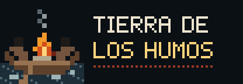
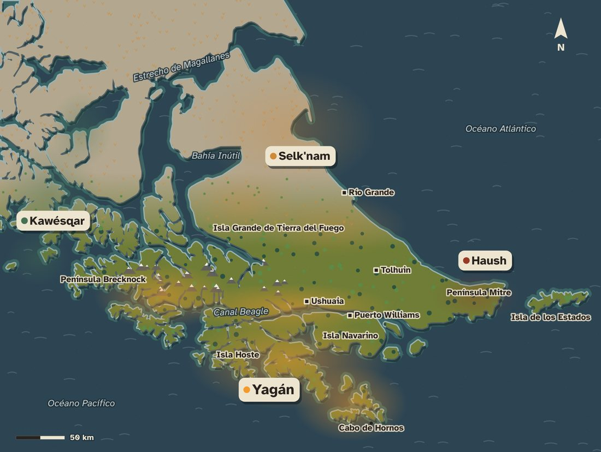
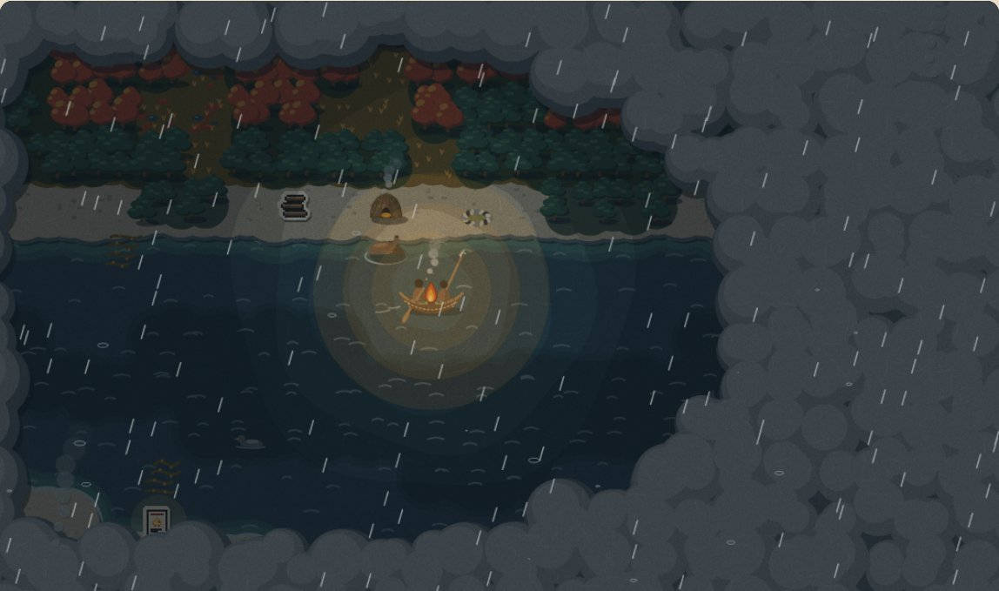
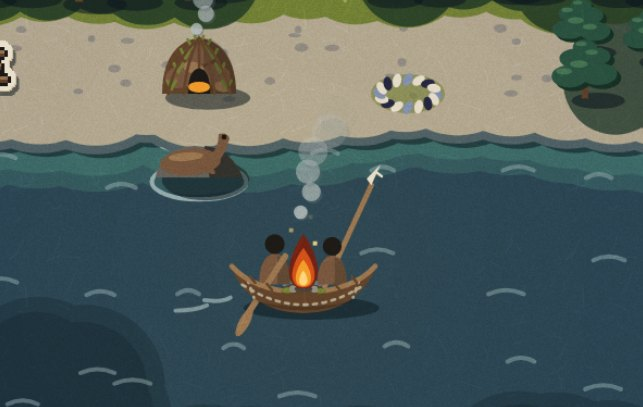
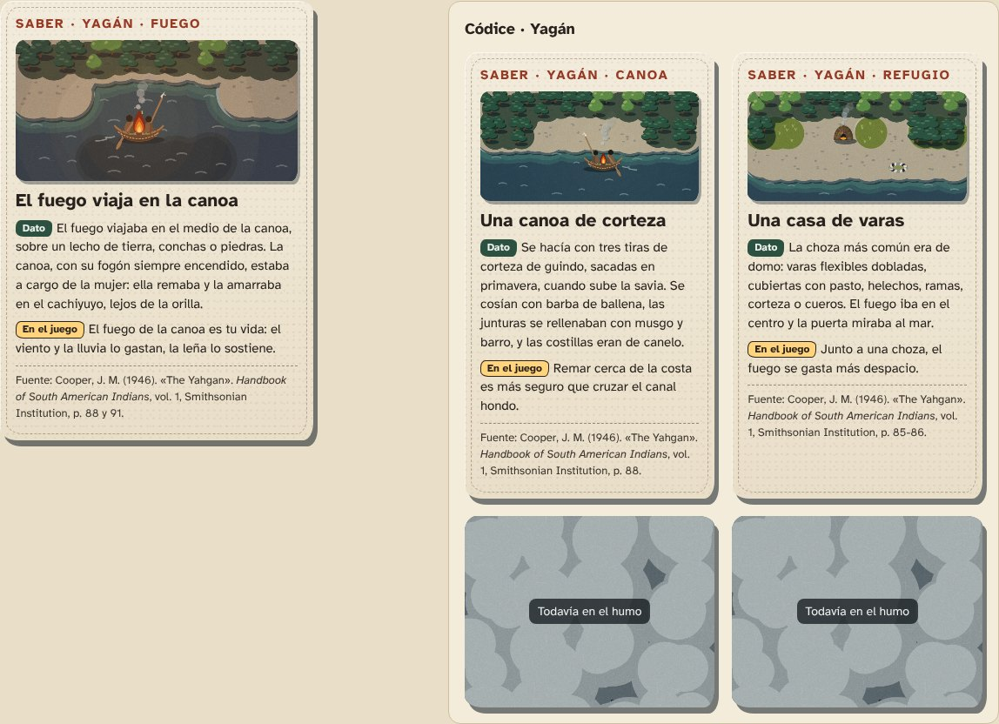
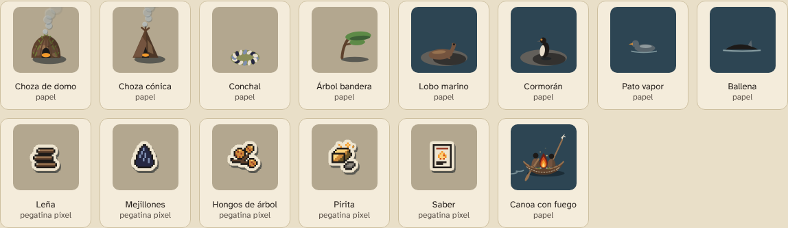

# 04 · Dirección de arte y sonido

> Versión 2 (12/11/2026). Responsable: Persona D (arte, sonido y comunicación).
> **Decisión del equipo (12/11):** el estilo es **Corteza**. Es un paisaje de papel recortado, y lo que se puede juntar aparece como pegatina en pixel art.
> El rigor histórico de cada elemento dibujado está auditado en [`05-rigor-historico.md`](05-rigor-historico.md). Lo marcado con 🔍 falta confirmarlo.



## En una frase

**Un mundo frío y gris, recortado en papel y corteza, donde lo único cálido es el fuego.** Todo lo que se ve en tonos tibios (el fuego, la luz, las cartas de saber) es lo que hay que cuidar. Lo que todavía no se conoce está cubierto de humo, como el que vieron los navegantes desde el mar.


## Cómo verlo

| Qué | Dónde | Cómo abrirlo |
|---|---|---|
| **El estilo, en vivo** | [`arte/corteza/index.html`](../arte/corteza/index.html) | Doble clic. Tocá el agua y la canoa rema. Anda sin internet. |
| **Mapa de territorios** | [`arte/mapa/index.html`](../arte/mapa/index.html) | Costas reales, zonas de cada pueblo con su fuente y capa de ciudades de hoy. También en la pantalla «¿A quién acompañás?». |
| **Pantallas del juego** (maqueta navegable) | [`arte/pantallas/index.html`](../arte/pantallas/index.html) | Título, elegir pueblo, viaje, carta de saber, fin del viaje, llegada, códice, cierre en presente y ayuda. |
| Motor de dibujo para el juego | [`arte/corteza/corteza.js`](../arte/corteza/corteza.js) | Ver la sección 6. |
| Cartas, códice y HUD (CSS) | [`arte/corteza/carta.css`](../arte/corteza/carta.css) | — |
| Logo, ícono e imagen para compartir | [`arte/logo/`](../arte/logo/) | Fuente: `arte/corteza/portada.html` |
| El sonido | [`sonido/demo.html`](../sonido/demo.html) | Doble clic y "Encender el sonido". |
| Las tres propuestas originales (registro) | [`arte/propuestas/index.html`](../arte/propuestas/index.html) | — |

---

## 1. Lo que miramos del territorio

| Elemento | Qué es | Cómo aparece | Fuente |
|---|---|---|---|
| Bosque de **guindo** | *Nothofagus betuloides*, de hoja perenne. Domina hacia la costa. Es el árbol de la corteza de las canoas. | Matas densas y oscuras, iguales todo el año. **No es un pino**: no se dibuja en punta. | Cooper (1946), p. 81 y 88; Multequina n.º 10 (IADIZA-CONICET). |
| Bosque de **lenga** y **ñire** | Pierden la hoja en otoño. | Copas redondas: verdes en verano, rojas y anaranjadas en otoño, grises con nieve en invierno. | Multequina n.º 10. Cooper (p. 81) llama «siempreverde» a la lenga; seguimos la botánica actual (ver `05`). |
| Turbales | Musgo *Sphagnum* que retiene agua como una esponja. | Cojines rojizos con charcos. | Multequina n.º 10; Spears (1895), p. 149. |
| Cachiyuyo | Algas grandes en el agua baja. Ahí se amarraba la canoa. | Cintas con flotadores dorados sobre el agua. | Cooper (1946), p. 88. |
| Playas | Canto rodado y grava. | Capa clara con piedras. | Observación. |
| Fauna | Lobo marino, cormorán, pato vapor, ballena. | Papel, descansando. **Nunca enemigos ni escenas de caza.** | Cooper (1946), p. 84. |
| Clima | Ráfagas violentas, cambios bruscos, nieve incluso en verano. | Viento, lluvia y nieve en cualquier estación. | Cooper (1946), p. 81. |
| El nombre | Los fuegos y el humo que los navegantes vieron en la costa. El fuego se usaba también para hacer señales. | El humo cubre lo no explorado; los fogones lejanos se ven como columnas de humo. | Billiken (origen del nombre); Cooper (1946), p. 91. |

## 2. Lo que miramos de la vida yagán

El detalle completo, elemento por elemento y con página, está en [`05-rigor-historico.md`](05-rigor-historico.md). Lo esencial para dibujar:

- **Canoa:**
  - tres tiras de corteza de guindo cosidas a lo largo con barba de ballena, con la borda atada;
  - las dos puntas iguales y levantadas;
  - el fogón en el medio, sobre tierra, conchas o piedras;
  - **el hombre adelante del fuego, con sus armas; la mujer atrás, que rema y maneja la canoa**;
  - remo de una pieza con pala larga;

  (Cooper, p. 88, 91 y 96; Spears, p. 56-57.)
- **Chozas:**
  - de domo (la más común, sobre todo hacia el oeste) o cónicas (más hacia el este);
  - varas cubiertas con pasto, helechos, ramas, corteza o cueros;
  - fuego en el centro; **la puerta mira al mar**;

  (Cooper, p. 85-86.)
- **Personas:** una capa chica de piel sobre los hombros, sin gorro y descalzas (Cooper, p. 86). En el juego son siluetas sin rasgos, hasta la consulta.
- **Comida:** sobre todo mejillones; después lobos marinos y peces; también hongos de árbol, que se guardaban secos (Cooper, p. 84).
- **Fuego:** se hacía golpeando pirita con pedernal (Cooper, p. 91).

## 3. Principios

1. **Frío afuera, cálido adentro.** Grises, verdes oscuros y azules apagados. Los colores cálidos fuertes son solo del fuego y del saber.
2. **Capas de papel.** Cada isla está hecha de capas recortadas, cada una con su borde ondulado: agua baja, espuma, sombra, playa, tierra, bosque.
3. **La luz viene del norte.** Como el sol en Tierra del Fuego. Todas las sombras caen hacia abajo y a la derecha, y los biseles claros quedan arriba a la izquierda.
4. **Lo que se junta es pegatina.** Leña, mejillones, hongos, pirita y saberes son pixel art con borde de papel. Si es pegatina, se puede agarrar; si es papel, es paisaje. Así se lee el juego de un vistazo.
5. **Lo desconocido es humo.** La niebla de guerra son nubes de humo recortadas, y los fogones lejanos, columnas de humo.
6. **El fuego es la interfaz.** El fuego del HUD *es* la barra de vida, siempre con el número al lado («Fuego 3 de 4»).
7. **Acompañar, no encarnar.** Las personas son siluetas chicas sin rasgos. La protagonista visual es la canoa con su fuego.
8. **Toda costa tiene espuma.** El agua y el guindo casi no se distinguen sin color (contraste 1,1:1), así que una línea clara los separa siempre.
9. **Fiel a las fuentes.** Nada se dibuja «porque queda lindo». Si no hay fuente, no va, o va marcado 🔍 (ver `05`).

### El mapa de los territorios



## 4. La escena según la hora y la estación



- **Luz en escalones:** de noche y al atardecer, la luz del fuego se abre en anillos de borde ondulado, como capas de papel de calco. Cuanto más fuerte el fuego, más lejos se ve.
- **Estaciones:** la lenga, el ñire, el suelo y la turba cambian de color; el guindo no. Son cuatro: primavera (hojas nuevas, verde claro), verano, otoño (rojo y anaranjado) e invierno (gris y nieve).
- **Luz real de Ushuaia** ([`arte/corteza/luz-real.js`](../arte/corteza/luz-real.js)): calcula dónde está el sol en Ushuaia en este momento, sin internet, con el algoritmo de posición solar de la NOAA (error de un par de minutos). Si el sol está a más de 6° sobre el horizonte es de día; entre 6° y −6°, amanece o atardece; más abajo, es de noche. La estación sale del mes, en el hemisferio sur. Así, en la demo del 19/11 el juego tiene la misma luz que hay en el canal Beagle (el sol sale a las 05:11 y se pone a las 21:27), y en junio la noche es larga (de 17:11 a 09:59). Se usa en el título y en el viaje de la maqueta (botón «Luz real de Ushuaia», encendido de entrada), en la vitrina («Hora real de Ushuaia») y en la vidriera del stand. El aviso dice, por ejemplo: «En Ushuaia ahora: de día. El sol se pone a las 21:13».
- **Clima:** la lluvia son tiras de papel y anillos en el agua; el viento, líneas curvas que tumban el humo; la nieve, puntos de papel.
- Todo el movimiento se puede apagar, y el motor respeta la opción de "reducir movimiento" del sistema.

## 5. La canoa



Es el único elemento que aparece en todas las pantallas, así que es lo más cuidado. Cada detalle sale de una fuente (ver `05`, sección «La canoa»):

- Casco simétrico, de luna creciente.
- Costura longitudinal y costuras cortas en las puntas.
- Borda clara atada.
- Fogón sobre un champón de tierra con pasto y piedras.
- El arpón en reposo, con punta de hueso dentada.
- La pala del remo, larga y angosta.

## 6. Para quien programa (Personas A y B)

```html
<script src="arte/fuente/arte.js"></script>      <!-- paleta y pegatinas pixel -->
<script src="arte/corteza/corteza.js"></script>  <!-- motor de dibujo Corteza -->
<script>
  const motor = TDH_CORTEZA.crear(miCanvas, { celda: 48 });
  motor.escena({
    mapa: ['GGLL...', '..,,--~', ...],          // ~ - , k r . p G L t M (ver el encabezado de corteza.js)
    objetos: [{ id: 'choza', x: 3, y: 1 }, { id: 'mejillones', x: 5, y: 1 }],
    canoa: { x: 4, y: 3, fuego: 3, mira: 1, remando: false },
    explorado: (x, y) => visto.has(x + ',' + y),  // sin esta función no hay niebla
    estacion: 'verano', clima: 'calma', hora: 'dia',
  });
  requestAnimationFrame(function cuadro(ms) { motor.dibujar(ms / 1000); requestAnimationFrame(cuadro); });
</script>
```

- **Objetos de papel:** `choza`, `choza-conica`, `conchal`, `arbol-bandera`, `guindo-grande`, `ballena-varada`, `lobo-marino`, `cormoran`, `pato-vapor`, `ballena`, `pinguino`, `cauquen`, `gaviota`, `tonina`.
- **Pegatinas:** `lena`, `mejillones`, `pescado`, `erizos`, `huevos`, `hongos`, `pirita`, `saber` (y cualquier sprite de `arte.js`).
- **Cámara para celular:** `motor.centrar(x, y, 10, 9)` muestra 10 × 9 casillas alrededor de la canoa. `motor.casillaEn(clientX, clientY)` convierte un toque en una casilla.
- **Rendimiento:** el mapa se arma una vez (entre 40 y 120 ms) y se vuelve a armar solo si cambian el mapa, la estación o lo explorado. Cada cuadro reusa esa base.
- **Para el HUD y las cartas:** `TDH_CORTEZA.fuego(ctx, x, y, escala, nivel, t)`, `TDH_CORTEZA.canoa(...)` y `TDH_CORTEZA.pegatina(idSprite, escala)`. Las clases CSS (`.carta-saber`, `.ficha`, `.codice`, `.boton-papel`) están en `carta.css`.
- **Luz real:** `TDH_LUZ_REAL.ahora()` devuelve `{ hora, estacion, texto }` para pasarlo a `motor.escena` (ver la sección 4).
- **Sonido por lugar:** `TDH_SONIDO.lugarDe(mapa, x, y)` devuelve `{ bosque, playa, mar }` para `sonido.ambiente` (ver la sección 12).
- **Transiciones** (`arte/corteza/transiciones.js`), listas para la interfaz:
  - `humoCubre` y `humoDescubre`: el humo tapa y destapa la pantalla al cambiar de una a otra;
  - `pasoDelFuego`: la brasa de la canoa apagada viaja hasta la canoa de la generación siguiente, con los saberes heredados (es un recurso de juego);
  - `cartaEntra`: la carta se despliega como un papel.

  Todas devuelven una promesa y respetan «reducir movimiento». Están en uso en la maqueta.
- La vitrina (`arte/corteza/index.html`) es un ejemplo completo: remar tocando el agua, buscar el camino por el agua, revelar el humo, la cámara que sigue a la canoa y el sonido.

## 7. Pantallas del juego

La maqueta [`arte/pantallas/index.html`](../arte/pantallas/index.html) muestra todo el recorrido con el estilo aplicado:

1. **Título**: escena animada, rótulo de papel y aviso de qué es ficción y qué no.
2. **Elegir pueblo**: la familia yagán está disponible; la kawésqar figura como «próximamente, con la consulta a sus comunidades».
3. **Viaje**: HUD de fichas, cámara sobre la canoa, botones grandes (*Juntar*, *Avivar el fuego*, *Amarrar y acampar*) y teclado (flechas o WASD, <kbd>Enter</kbd>, <kbd>F</kbd>, <kbd>M</kbd>).
4. **Carta de saber**: aparece encima del mapa cuando se junta algo nuevo.
5. **Fin del viaje**: el fuego se apaga y se listan los saberes que pasan a la generación siguiente.
6. **Llegada**: la ballena varada, con humo de otras familias que se acercan (destino de ejemplo).
7. **Códice**: separado por pueblo, con las cartas no encontradas tapadas por humo.
8. **Hoy**: el cierre en presente. El texto es provisorio y se escribe con la comunidad.
9. **Cómo se juega**: la ayuda.

La maqueta incluye un **bucle de prueba**, no el motor del juego: el fuego se gasta al remar (más con viento en el canal hondo o con lluvia), la leña lo aviva, la pirita lo vuelve a encender una vez, el amarre en el cachiyuyo hace pasar la noche, y los saberes quedan en la memoria del linaje. Sirve como referencia de interfaz y de ritmo para A y B. Los números son de prueba.

Los textos de las cartas de la maqueta (fuego, amarre, mejillones, pesca sin anzuelo, hongos, pirita, choza, corteza y ballena varada) salen de Cooper (1946), con página. Son **borradores para la Persona C**.

### Postal del viaje

Al terminar un viaje (fin o llegada), la maqueta ofrece «Ver la postal del viaje»: una imagen de 1200 × 800 con el mapa y el recorrido como un hilo punteado, la generación, cómo terminó, los saberes aprendidos y un recuadro del mapa real de los canales. Se guarda como PNG para compartir o llevar del stand. La genera `arte/postal/postal.js`. Aclara que la familia y el mapa son ficción y los saberes no.

## 8. Cartas de saber y códice



- **La carta es papel:** fondo `#eee5d0`, tinta `#28221e`, borde cortado a mano, costura punteada y sombra al sureste.
- **Orden fijo:**
  1. tipo (pueblo y tema);
  2. ilustración, dibujada con el mismo motor del mapa;
  3. título;
  4. **Dato**, con etiqueta verde;
  5. **En el juego**, con etiqueta amarilla;
  6. fuente con página, al pie.
- **Códice:** grilla de cartas separada por pueblo. Las cartas no encontradas están tapadas por humo.
- **Cierre del códice:** una pantalla en presente, con las comunidades de hoy. 🔍 Consultar con la comunidad cómo quiere verse.

## 9. Elementos



El pixel art de la primera ronda (propuesta A) queda como **capa secundaria**: sus íconos se usan como pegatinas y en el HUD. Los tiles pixel se conservan en `arte/sprites/` como registro, pero el mapa del juego se dibuja con el motor Corteza.

## 10. Paleta «Canales» (42 colores)


| Capa | Colores clave | Regla |
|---|---|---|
| Agua | `#1d2e38` canal hondo · `#2d4553` canal · `#3d6866` agua baja · `#9db3b6` espuma | Gris verdoso, nunca azul de postal. |
| Tierra | `#b3a78f` grava · `#8f897f` canto rodado · `#6f7d36` musgo · `#7e3529` turba | Bisel claro arriba a la izquierda, sombra abajo a la derecha. |
| Bosque | `#1a3227` `#2c5140` `#457052` guindo · `#5d8a47` lenga · `#b0462e` lenga en otoño | El guindo no cambia; la lenga sí. |
| Humo | `#59656c` · `#8e999c` · `#c3cbca` · `#eef2ef` nieve | Niebla, columnas de humo, nieve. |
| Madera y cuero | `#5e412c` corteza · `#977250` corteza clara · `#74543f` cuero | Canoa, chozas, capas. |
| Fuego y saber | `#6e2116` · `#d24e1c` · `#f39a2c` · `#ffd47c` | **Solo** fuego y saber. |
| Papel | `#eee5d0` papel · `#28221e` tinta · `#973a25` ocre | Cartas, fichas y borde de las pegatinas. |

**Contraste (WCAG 2.1):**

| Texto | Contraste | Nivel |
|---|---|---|
| Tinta sobre papel | 12,5:1 | AAA |
| Ocre sobre papel | 5,7:1 | AA |
| Papel sobre noche | 15,2:1 | AAA |
| Etiqueta «Dato» | 7,9:1 | AAA |
| Etiqueta «En el juego» | 11,2:1 | AAA |

## 11. Tipografía

- **Atkinson Hyperlegible** (Braille Institute of America, licencia SIL OFL 1.1), pensada para baja visión. Va incluida en `arte/tipografia/`, así que funciona sin internet.
- Tamaño mínimo: 16 px en el juego y 15 px en las cartas.

## 12. Sonido

Todo el sonido se **genera con código** (`sonido/ambiente.js`, unos 18 KB): viento, mar, lluvia, fuego y efectos (remo, ola, leña, mariscos, saber, fuego apagado, nueva generación). Cada efecto tiene su subtítulo en pantalla.

**El lugar suena distinto:** cerca del bosque, las hojas suenan con el viento y cruje alguna rama; en la playa, la resaca arrastra piedritas y valvas después de cada ola; en el canal abierto, el mar es más grave y fuerte. Lo calcula `TDH_SONIDO.lugarDe(mapa, x, y)` con las casillas que rodean a la canoa. No se imitan aves ni animales. **Sin música inventada:** no imitamos cantos yaganes. Detalle en [`sonido/README.md`](../sonido/README.md).

## 13. Accesibilidad

- [x] Contraste AAA en los textos.
- [x] Costa con espuma, para no depender del color.
- [x] Simulación de daltonismo en la vitrina.
- [x] El fuego siempre con su número al lado.
- [x] Las pegatinas tienen un borde claro: se distinguen del paisaje por la forma, no solo por el color.
- [x] Subtítulos de sonido.
- [x] **Cartas leídas en voz alta** (`sonido/voz.js`, con la voz del dispositivo), para quien lee con dificultad o ve poco.
- [x] **El lugar suena distinto** (bosque, playa, canal): el mapa también se puede «leer» con el oído.
- [x] Movimiento que se puede apagar, y respeta "reducir movimiento".
- [x] Cámara que sigue a la canoa en el celular, con zonas táctiles grandes.
- [x] Tipografía para baja visión.
- [x] **Modo alto contraste** (opción `altoContraste` del motor): costa con franja blanca y contorno que se ve también de noche, noche que nunca tapa del todo, humo con contorno, pegatinas con borde oscuro, anillo en la canoa y sin grano de papel. Botón en la vitrina y en el título de la maqueta.
- [x] Textos alternativos de cada carta (campo `alt` en `datos/saberes.js`). Describen solo lo que está dibujado; los revisa la Persona C.
- [ ] Probar en un celular de gama baja y en el proyector.

## 14. Líneas rojas aplicadas al arte

- ❌ Fotos históricas o ilustraciones de terceros. Todo el arte es propio.
- ❌ Seres ceremoniales, ritos (*ciéxaus*, *kina*), pintura corporal o adornos.
- ❌ Rasgos físicos: las personas son siluetas con capa.
- ❌ Violencia o escenas de caza. La fauna aparece descansando.
- ❌ Objetos que las fuentes no respaldan: perros, anzuelos, redes, cerámica, canoas de tablas, arcos como arma principal (ver `05`).
- ❌ Guardas o grecas «indígenas» inventadas como decoración.
- ✅ Los peligros se dibujan como clima: viento, lluvia, nieve, oleaje, noche.

## 15. Preguntas de arte para la consulta

1. ¿Podemos mostrar personas, aunque sean siluetas sin rasgos? ¿Cómo prefieren que se vean?
2. ¿Está bien mostrar a la mujer remando atrás y al hombre adelante con el arpón, como dicen las fuentes?
3. ¿Hay colores, formas u objetos que no deberían aparecer?
4. ¿Podemos usar la imagen de un cesto de junco (por ejemplo, para el códice)?
5. ¿Cómo quieren que se vea la pantalla final, la del presente de la comunidad?
6. ¿Hay música o sonidos que quieran compartir, o que no deberían usarse?

## 16. Referencias de estilo

Tomamos principios, no copiamos ningún juego.

- ***Never Alone*** (Upper One Games y el Cook Inlet Tribal Council, 2014): un juego hecho junto a la comunidad iñupiat, con videos culturales que se desbloquean, como nuestro códice.
- *Kentucky Route Zero*, *Alto's Odyssey* y *The Long Dark*: formas planas, luz serena, el frío pintado.
- *Don't Starve* y *Dredge*: el fuego y la luz contra la oscuridad, y la niebla sobre el agua.

## Fuentes

Las fuentes etnográficas están en [`05-rigor-historico.md`](05-rigor-historico.md). Además:

- Billiken. *¿Por qué Tierra del Fuego tiene ese nombre?* https://billiken.lat/mi-pais/por-que-tierra-del-fuego-tiene-ese-nombre/
- Braille Institute of America. *Atkinson Hyperlegible* (SIL OFL 1.1). https://github.com/googlefonts/atkinson-hyperlegible
- Cooper, J. M. (1946). «The Yahgan». En *Handbook of South American Indians*, vol. 1, pp. 81-106. Smithsonian Institution. https://archive.org/details/bulletin14311946smit
- Denver Art Museum. *The Story Behind How an Alaska Native Story Led to a Video Game*. https://denverartmuseum.org/article/story-how-alaska-native-story-led-video-game
- NOAA Global Monitoring Laboratory. *Solar Calculation Details* (algoritmo de posición solar, basado en Meeus, *Astronomical Algorithms*). https://gml.noaa.gov/grad/solcalc/calcdetails.html
- Machado, G., Oliveira, M. y Fernandes, L. (2009). *A Physiologically-based Model for Simulation of Color Vision Deficiency*. IEEE TVCG 15(6).
- Multequina n.º 10 (IADIZA-CONICET). https://www.mendoza.conicet.gov.ar/portal/multequina/indice/pdf/10/10_1.pdf 🔍 autores y título.
- Spears, J. R. (1895). *The Gold Diggings of Cape Horn*. Putnam. https://www.gutenberg.org/ebooks/39109
- W3C. *WCAG 2.1*. https://www.w3.org/TR/WCAG21/
