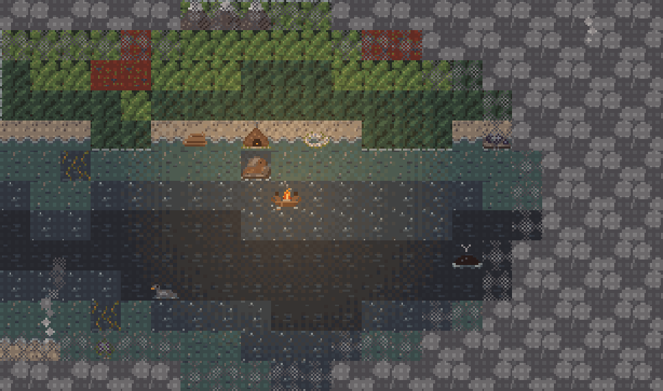
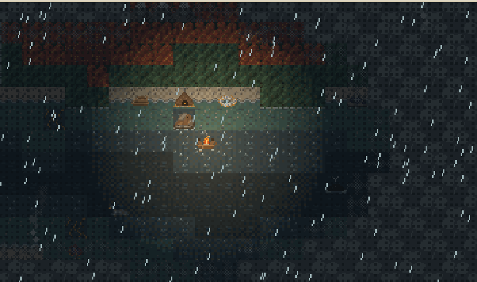
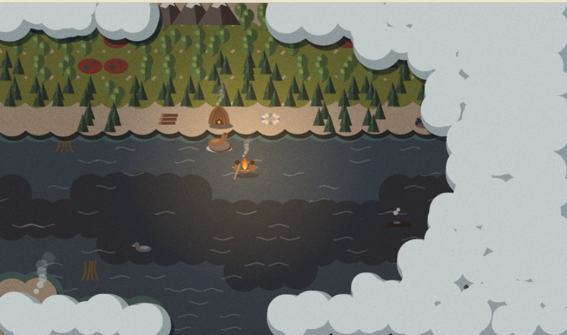
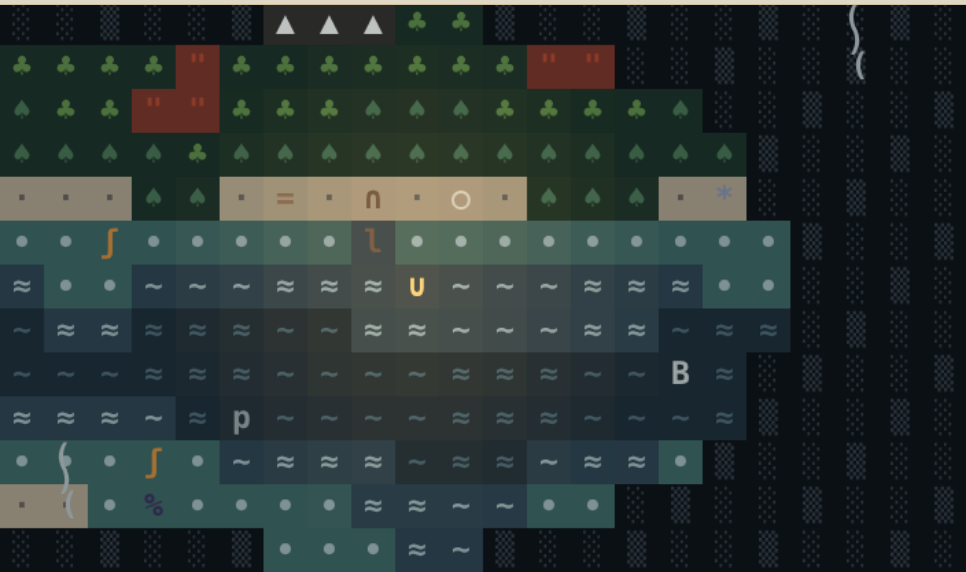
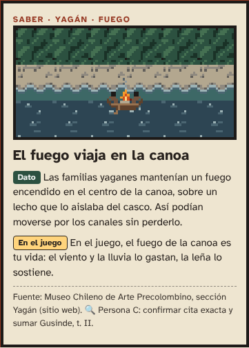
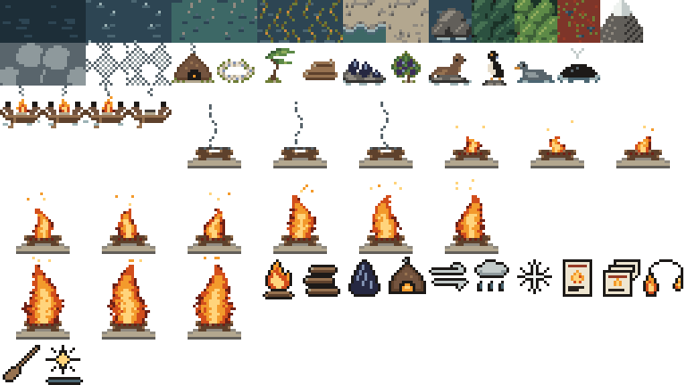

# 04 · Dirección de arte y sonido

> Versión 1 (12/11/2026). Responsable: Persona D (arte, sonido y comunicación).
> Estado: **tres propuestas de estilo listas para elegir en equipo** y un primer set de arte y sonido ya usable. Lo marcado con 🔍 hay que confirmarlo con fuentes o con la comunidad (Persona C).

## En una frase

**Un mundo frío y gris donde lo único cálido es el fuego.** Todo lo que se ve en tonos tibios (el fuego, la luz, las cartas de saber) es lo que hay que cuidar. Lo que todavía no se conoce está cubierto de humo, como el que vieron los navegantes desde el mar.

## Cómo verlo

| Qué | Dónde | Cómo abrirlo |
|---|---|---|
| Las tres propuestas, interactivas | [`arte/propuestas/index.html`](../arte/propuestas/index.html) | Doble clic en el archivo. Anda sin internet. |
| El sonido | [`sonido/demo.html`](../sonido/demo.html) | Doble clic y "Encender el sonido". |
| Sprites sueltos y hoja de sprites | [`arte/sprites/`](../arte/sprites/), [`arte/hoja-sprites.png`](../arte/hoja-sprites.png) | Cualquier visor de imágenes. |
| Cómo editar o regenerar el arte | [`arte/README.md`](../arte/README.md) | — |

---

## 1. Lo que miramos del territorio

El arte tiene que **enseñar el territorio**, no decorarlo (25 puntos de pertinencia). Por eso cada tile y cada color sale de algo real.

| Elemento | Qué es | Cómo aparece en el arte | Fuente |
|---|---|---|---|
| Bosque de **guindo** | *Nothofagus betuloides*, el único de los *Nothofagus* fueguinos de hoja perenne. Domina hacia la costa del canal Beagle. | Tile `bosque-guindo`: verde oscuro, igual todo el año. Es el bosque que toca el mar. | Multequina n.º 10 (IADIZA-CONICET); Allué et al., *Forest Systems* (CSIC). 🔍 autores y años exactos |
| Bosque de **lenga** y **ñire** | *N. pumilio* y *N. antarctica*: pierden la hoja en otoño. | Tile `bosque-lenga`: verde en verano, rojo y anaranjado en otoño, gris con nieve en invierno. El juego cambia de estación cambiando colores. | Ídem. |
| **Canelo** y **notro** | Aparecen en el bosque costero húmedo del Beagle. | Reservados para cartas o detalles futuros. | Ídem. 🔍 |
| **Turbales** | Turberas dominadas por el musgo *Sphagnum magellanicum*, rojizas. | Tile `turbal`: rojo oscuro con charcos. | Ídem; Universidad de Connecticut (briología, prensa 2020). 🔍 |
| **Calafate** | Arbusto con frutos violeta oscuro. | Sprite `calafate`, color `calafate`. | 🔍 Persona C: sumar fuente botánica. |
| **Cachiyuyo** | Bosques de algas gigantes en el agua baja. | Tile `cachiyuyo`: tallos ocres en el agua. | 🔍 Persona C: fuente (y si se usaba para amarrar la canoa). |
| **Fauna del Beagle** | Cormorán imperial, pato vapor, lobos marinos, pingüino de Magallanes. | Sprites `cormoran`, `pato-vapor`, `lobo-marino`, `ballena`. **Nunca como enemigos.** | Guías de navegación del Beagle (Interpatagonia). 🔍 reemplazar por una guía de aves y mamíferos marinos. |
| **Playas de canto rodado** | Costas de grava y piedra redondeada, no de arena. | Tiles `grava` y `orilla`. | Observación del paisaje. |
| **Árboles bandera** | Árboles torcidos por el viento del oeste. | Sprite `arbol-bandera`. Le dice al jugador de dónde viene el viento. | 🔍 Persona C. |
| **Cielo cubierto y clima cambiante** | Luz gris, cambios rápidos de clima. | Paleta de cielo en grises; el clima cambia el color, no solo agrega lluvia. | Observación. |
| **El nombre** | Los fuegos y el humo que los navegantes vieron en la costa. Las fuentes registran "Tierra de los Humos" y "Tierra de los Fuegos" desde temprano; la anécdota de que Carlos V cambió el nombre no tiene respaldo claro. | El humo es la niebla de guerra y los fogones lejanos se ven como columnas de humo. | Billiken, *¿Por qué Tierra del Fuego tiene ese nombre?* 🔍 Persona C: fuente primaria (Pigafetta o cartografía del siglo XVI). |

## 2. Lo que miramos de la vida yagán

Solo lo que tiene fuente y que el arte necesita. El contenido de las cartas lo escribe y valida la Persona C.

| Tema | Qué dicen las fuentes | Cómo lo usamos | Fuente |
|---|---|---|---|
| **Canoa de corteza** | Tres piezas largas de corteza cosidas con tendones o tiras de cuero de lobo marino. Corteza de coigüe de Magallanes (guindo). | Casco de corteza marrón con costuras claras. | Universidad de Chile, *Cultura material yagán*; Museo Nacional de Historia Natural (Chile), guía que cita a Gusinde (ed. 1986). |
| **Forma de la canoa** | "Como una luna nueva con los extremos levantados"; la proa alta ayudaba con las olas. | Silueta del sprite `canoa` y del logo. | Lothrop (1928), citado en un recurso del Ministerio de Educación de Chile. 🔍 |
| **El fuego a bordo** | Se mantenía encendido en un recinto en el centro de la canoa. Las fuentes difieren sobre el lecho: arena, arcilla, piedras o pasto. | Fogón en el centro sobre un lecho claro. Es la imagen central del juego. | Museo Chileno de Arte Precolombino, *Yagán*. 🔍 materiales del lecho |
| **Quién rema** | Según el Museo Chileno de Arte Precolombino, remaban las mujeres. | La figura de atrás rema. Las figuras **no tienen rasgos ni género marcado** hasta la consulta. | Museo Chileno de Arte Precolombino. 🔍 confirmar con Chapman y Gusinde |
| **Mariscos y fuego** | Las mujeres buceaban en busca de mariscos y cuidaban que el fuego no se apagara. | Sprite `mejillones`, ícono `comida`. | Memoria Chilena. 🔍 |
| **Vivienda** | Estructura cupular o cónica de varas, cubierta con cueros de lobo marino, ramas y cortezas, con un agujero arriba para el humo. | Sprite `choza` con su hilo de humo. | Universidad de Chile, *Cultura material yagán*. |
| **Conchales** | Acumulaciones de valvas de cholgas y mejillones junto a las chozas. Hoy son sitios arqueológicos del Beagle. | Sprite `conchal`: marca un lugar donde hubo campamento. Puede ser un buen lugar para que aparezcan saberes. | Recursos educativos chilenos; Proyecto Arqueológico Canal Beagle (CADIC-CONICET). 🔍 |
| **Vestimenta** | Una capa de cuero de lobo marino o de nutria sobre los hombros. Se untaban la piel con grasa para protegerse del frío. | Las siluetas llevan una capa color `cuero`. Nada más. | Universidad de Chile, *Cultura material yagán*. |
| **Encender fuego** | Con pirita, pedernal y yesca, guardados en una bolsa de cuero. | Idea de carta y de ícono futuros. | Recurso del Ministerio de Educación de Chile. 🔍 |
| **Cestería de junco** | La siguen haciendo miembros de la comunidad yagán. | **No la usamos** como ícono sin preguntar (idea: el códice como un cesto). | Universidad de Chile. |
| **Pintura corporal** | Blanco, rojo y negro, con significados sociales y ceremoniales. | **No la usamos.** El ocre rojo aparece solo como color de interfaz, nunca sobre personas. | Recurso del Ministerio de Educación de Chile. |

## 3. Principios

1. **Frío afuera, cálido adentro.** El paisaje usa grises, verdes oscuros y azules apagados. Los colores cálidos fuertes son solo del fuego y del saber. Si algo brilla en tonos tibios, importa.
2. **El fuego es la interfaz.** El fuego grande del HUD *es* la barra de vida: 5 tamaños, del vivo a las brasas. Al lado va siempre el número ("Fuego 3/4"), para que no dependa solo de la imagen.
3. **Lo desconocido es humo.** La niebla de guerra es humo. Los fogones lejanos se ven como columnas de humo por encima: el nombre de la isla, convertido en mecánica.
4. **Acompañar, no encarnar.** Las personas son siluetas chicas, sin cara ni rasgos, con su capa. La protagonista visual es la canoa con el fuego. Así el arte funciona tanto si la comunidad dice "pueden jugar como" como si dice "acompañen".
5. **El territorio manda.** Cada tile es algo que existe en los canales. Nada de fantasía, nada de monstruos.
6. **Sereno.** Animaciones lentas (agua cada 0,45 s, fuego en 3 cuadros). Sin destellos. Se puede apagar todo el movimiento.
7. **Se lee sin color.** Agua y tierra se distinguen por textura y por la línea de espuma de la costa, no solo por el tono (ver la sección 6).

## 4. Las tres propuestas

La misma escena, el mismo atardecer de verano, con el fuego en 3 de 4. En la página interactiva se puede cambiar estación, clima, hora y fuego, y simular daltonismo.

### A · Brasa: pixel art de 16 px

Roguelike clásico de grilla con la luz del fuego como protagonista: cuanto más fuerte el fuego, más lejos se ve, con un tramado que mantiene el aspecto pixel. Ya tiene 42 sprites, 3 estaciones, hoja de sprites y atlas listos para el motor.

### B · Corteza: formas planas recortadas

Capas planas como papel o corteza recortada, con sombra y grano. Muy lindo en pantallas grandes y celulares modernos, pero cada objeto es código de dibujo: más lento de producir.

### C · Signo: roguelike de símbolos

La tradición más antigua del género. Casi sin costo de arte, pero es la que menos cuenta del territorio y la menos atractiva para el público de la demo.

### Comparación

| Criterio | A · Brasa | B · Corteza | C · Signo |
|---|---|---|---|
| Tiempo de producción (quedan 5 días) | Bajo: el set base ya existe | Medio a alto | Muy bajo |
| Cuenta el territorio (pertinencia) | Alto | Muy alto | Bajo |
| Se lee en celular | Bien, con escala entera | Muy bien | Bien, con letra grande |
| Peso y conexión lenta | Muy liviano | Liviano | Mínimo |
| Atractivo para la demo | Alto | Alto | Medio |
| Lo puede editar todo el equipo | Sí (sprites en texto) | Solo quien programa | Sí |

## 5. Recomendación

**A · Brasa para el mapa, y las cartas y el códice en papel (lo mejor de B).** Es lo que mejor equilibra tiempo, calidad y lectura del territorio. Las cartas con fondo de papel y tinta oscura son lo más legible para textos con fuentes citadas.

> **Decisión pendiente del equipo.** Para decidir: cada integrante mira las tres en su celular, prueba *noche + lluvia + fuego en 1* y *Ver como: deuteranopía*, vota una y dice qué cambiaría. La decisión se anota con fecha en `equipo/memory.md`.

## 6. Paleta «Canales» (42 colores)

Los 42 colores, con nombre y de dónde sale cada uno, están en [`arte/paleta/paleta.json`](../arte/paleta/paleta.json) y en la página de propuestas. También hay versiones para Aseprite, GIMP y Krita (`.gpl`) y para Lospec (`.hex`).

| Grupo | Colores clave | Para qué |
|---|---|---|
| Mar | `#1d2e38` mar hondo · `#2d4553` mar · `#3d6866` agua somera · `#9db3b6` espuma | El canal es gris verdoso, casi nunca azul de postal. |
| Cielo y humo | `#59656c` humo oscuro · `#8e999c` humo · `#c3cbca` niebla · `#eef2ef` nieve | Niebla de guerra, columnas de humo, cumbres. |
| Piedra | `#625f5a` piedra · `#8f897f` canto rodado · `#b3a78f` grava | Costas y lecho del fogón. |
| Bosque | `#2c5140` guindo · `#5d8a47` lenga · `#b0462e` lenga en otoño · `#cf8a3a` ñire en otoño · `#7e3529` turba | El bosque cambia con la estación; el guindo no. |
| Madera | `#5e412c` corteza · `#977250` corteza clara · `#74543f` cuero | Canoa, choza, capas. |
| Fuego | `#6e2116` brasa · `#d24e1c` fuego · `#f39a2c` llama · `#ffd47c` luz | **Solo** fuego y saber. |
| Interfaz | `#eee5d0` papel · `#28221e` tinta · `#973a25` ocre | Cartas de saber y códice. |

### Contraste (WCAG 2.1)

| Uso | Colores | Contraste | Nivel |
|---|---|---|---|
| Texto de las cartas | tinta sobre papel | 12,5:1 | AAA |
| Tipo de carta | ocre sobre papel | 5,7:1 | AA |
| Texto del HUD | papel sobre noche | 15,2:1 | AAA |
| Acento de saber | luz sobre noche | 13,6:1 | AAA |
| Etiqueta «Dato» | nieve sobre guindo | 7,9:1 | AAA |
| Etiqueta «En el juego» | tinta sobre luz | 11,2:1 | AAA |
| **Agua junto a guindo** | mar y guindo | **1,1:1** | ⚠️ No se distinguen por luminosidad |

⚠️ **Regla para el motor:** como el agua y el guindo casi no se distinguen sin color, **toda costa lleva una línea de espuma** (`#9db3b6`) donde la tierra toca el agua. Ya está hecho así en la propuesta A.

## 7. Sprites

| Categoría | Sprites | Tamaño | Cuadros |
|---|---|---|---|
| Terreno | `mar-hondo`, `mar`, `agua-somera`, `cachiyuyo`, `orilla`, `grava`, `roca`, `bosque-guindo`, `bosque-lenga`, `turbal`, `montana`, `niebla`, `niebla-borde` | 16 × 16 | El agua, las algas y la niebla tienen 2 |
| Lugares | `choza`, `conchal`, `arbol-bandera` | 16 × 16 | 1 |
| Recursos | `lena`, `mejillones`, `calafate` | 16 × 16 | 1 |
| Fauna | `lobo-marino`, `cormoran`, `pato-vapor`, `ballena` | 16 × 16 | 1 |
| Canoa | `canoa` (con fuego), `canoa-apagada` | 16 × 16 | 3 y 1 |
| Fuego del HUD | `fuego-apagado`, `fuego-brasas`, `fuego-debil`, `fuego-parejo`, `fuego-vivo` | 32 × 32 | 3 cada uno |
| Íconos | `icono-fuego`, `icono-lena`, `icono-comida`, `icono-refugio`, `icono-viento`, `icono-lluvia`, `icono-frio`, `icono-saber`, `icono-codice`, `icono-generacion`, `icono-remo`, `icono-calma` | 16 × 16 | 1 |

**Para quien programa (Personas A y B):** usen [`arte/hoja-sprites.png`](../arte/hoja-sprites.png) y su atlas [`arte/hoja-sprites.json`](../arte/hoja-sprites.json) (hay una hoja por estación). Dibujen siempre en **escala entera** (×2, ×3, ×4) y con `imageSmoothingEnabled = false`. Otra opción es cargar [`arte/fuente/arte.js`](../arte/fuente/arte.js) y usar `TDH_ARTE.aCanvas(id, cuadro, estacion, escala)`. El detalle está en [`arte/README.md`](../arte/README.md).

**Faltan (próximos días):** tiles de borde de costa en las 4 direcciones, guanaco y cholga si las cartas los usan, el destino del viaje (🔍 depende de la investigación de la Persona C) y las ilustraciones de cada carta.

## 8. Cartas de saber y códice

- **Formato:** fondo papel (`#eee5d0`), texto tinta (`#28221e`), marco oscuro con filete ocre. Ilustración pixel arriba, a 96 × 48 px escalada.
- **Orden fijo:** tipo (pueblo y tema) → ilustración → título → **Dato** (etiqueta verde) → **En el juego** (etiqueta amarilla) → fuente, al pie y separada por una línea.
- **El ícono del saber** es una carta con una llama: el saber se ve como fuego, porque se transmite como el fuego.
- **Códice:** la misma carta, en una grilla separada por pueblo. Las cartas no encontradas se ven como humo, no como signos de pregunta.
- **Cierre del códice:** una pantalla final en presente, con la comunidad viva. Arte propuesto: el canal de hoy con humo de una casa actual. 🔍 Consultar con la comunidad cómo quiere verse.

## 9. Tipografía

- **Atkinson Hyperlegible** (Braille Institute of America, licencia SIL OFL 1.1) para todos los textos. Está pensada para baja visión: distingue bien las letras que se confunden (I, l, 1; O, 0). Va incluida en [`arte/tipografia/`](../arte/tipografia/) para que ande sin internet.
- **Letras pixel propias** (5 × 7) solo para el logo. Son del equipo, así que no suman licencias.
- Tamaño mínimo de texto en el juego: 16 px; en cartas, 15 px con interlineado de 1,45.

## 10. Sonido

Todo el sonido se **genera con código** ([`sonido/ambiente.js`](../sonido/ambiente.js), unos 10 KB): no hay archivos de audio, no hay licencias de terceros y anda sin internet.

| Capa o evento | Cómo suena | Qué lo controla | Subtítulo en pantalla |
|---|---|---|---|
| Viento | Ruido filtrado con ráfagas al azar; con viento fuerte, un silbido | Clima (0 a 1) | — (se ve en las líneas de viento) |
| Mar | Ruido grave que sube y baja cada 7 a 9 segundos, con olas que rompen | Oleaje (0 a 1) | — |
| Lluvia | Siseo agudo y gotas | Clima (0 a 1) | — (se ve la lluvia) |
| Fuego | Rumor grave y crepitar; más fuego, más chispazos | Nivel de fuego (0 a 4) | — (se ve el fuego) |
| `remo` | La pala entra al agua | Moverse | [Remada] |
| `lena` | Dos golpes de madera | Sumar leña | [Se agrega leña al fuego] |
| `comida` | Valvas que chocan | Juntar mariscos | [Se juntan mariscos] |
| `saber` | Golpe de madera resonante y su quinta | Carta nueva | [Aprendiste un saber] |
| `apagado` | Siseo que baja y un golpe sordo | El fuego se apaga | [El fuego se apagó] |
| `generacion` | Acorde grave que crece | Empieza una nueva generación | [Comienza una nueva generación] |

**Sin música inventada.** No imitamos cantos yaganes: son patrimonio de la comunidad. Si la comunidad comparte música o grabaciones y autoriza su uso, se suma con su permiso y su crédito. 🔍 Pregunta para la consulta.

## 11. Accesibilidad (arte y sonido)

- [x] Contraste AAA en todos los textos (sección 6).
- [x] Costa marcada con espuma, para no depender del color.
- [x] Simulación de protanopía, deuteranopía, tritanopía y grises en la página de propuestas.
- [x] El fuego del HUD siempre con número al lado.
- [x] Íconos con contorno oscuro: se leen sobre cualquier fondo.
- [x] Subtítulos para cada efecto de sonido (`sonido.alSonar(...)`).
- [x] Todo el movimiento se puede apagar, y respeta "reducir movimiento" del sistema.
- [x] Tipografía para baja visión, incluida en el repositorio.
- [ ] Textos alternativos de cada carta (Persona B, con los textos de la Persona C).
- [ ] Probar en un celular de gama baja y con el proyector de la demo.

## 12. Líneas rojas aplicadas al arte

- ❌ Ninguna foto histórica (tampoco las de Gusinde) ni ilustraciones de terceros. Todo el arte es propio.
- ❌ Ningún ser ceremonial, ni como enemigo ni como decoración.
- ❌ Nada de pintura corporal, máscaras ni adornos sobre las personas.
- ❌ Ningún rasgo físico estereotipado: las personas son siluetas con capa.
- ❌ Ninguna violencia. La fauna es paisaje y sustento, nunca un enemigo.
- ❌ Ningún motivo "indígena" genérico (guardas, grecas) inventado como decoración.
- ✅ Los peligros se dibujan como clima: viento, lluvia, nieve, oleaje, noche.

## 13. Preguntas de arte para la consulta

Para que la Persona C las sume a las de `equipo/comunicaciones.md`:

1. ¿Podemos mostrar personas, aunque sean siluetas sin rasgos? ¿Cómo prefieren que se vean?
2. ¿Está bien mostrar a una mujer remando atrás y el fuego en el centro?
3. ¿Hay colores, formas u objetos que no deberían aparecer?
4. ¿Podemos usar la imagen de un cesto de junco (por ejemplo, para el códice)?
5. ¿Cómo quieren que se vea la pantalla final, la del presente de la comunidad?
6. ¿Hay música o sonidos que quieran compartir, o que no deberían usarse?

## 14. Referencias y precedentes

Tomamos principios, no copiamos el estilo ni los elementos de ningún juego.

| Referencia | Qué tomamos |
|---|---|
| ***Never Alone*** (Upper One Games y Cook Inlet Tribal Council, 2014) | El precedente más importante: un juego hecho **junto** a la comunidad iñupiat, con su permiso para usar cada historia y videos culturales que se desbloquean (como nuestro códice). Su lema: ser "estudiantes, no prestatarios". |
| *Brogue* | La luz de colores en un roguelike de grilla. |
| *Hoplite* | Roguelike por turnos pensado para pantallas táctiles. |
| *Don't Starve* | El fuego como lo que mantiene a raya la oscuridad. |
| *Dredge*, *Sunless Sea* | Navegar con niebla, recursos que se gastan y miedo a la noche. |
| *Kentucky Route Zero*, *Alto's Odyssey*, *The Long Dark* | Formas planas, degradés serenos, el frío pintado (propuesta B). |

## 15. Pendientes del arte

| Cuándo | Qué |
|---|---|
| 12/11 | ✅ Propuestas, paleta, primer set de sprites, sonido, logo. **Falta que el equipo vote el estilo.** |
| 13/11 | Ajustar lo que pida el equipo. Bordes de costa. Revisar con A y B cómo cargan la hoja de sprites. |
| 14/11 | Capturas para el avance documentado (ver `equipo/comunicacion.md`). |
| 15/11 | Ilustraciones de las cartas (una por carta, 96 × 48). Arte del destino del viaje. README. |
| 16/11 | Video y pitch. |

## Fuentes

- Allué, C. et al. Artículo sobre los bosques de *Nothofagus* de Tierra del Fuego. *Forest Systems* (CSIC). https://fs.revistas.csic.es/index.php/fs/article/download/1314/1291/ 🔍 título y año.
- Billiken. *¿Por qué Tierra del Fuego tiene ese nombre?* https://billiken.lat/mi-pais/por-que-tierra-del-fuego-tiene-ese-nombre/
- Braille Institute of America. *Atkinson Hyperlegible* (SIL OFL 1.1). https://github.com/googlefonts/atkinson-hyperlegible
- Denver Art Museum. *The Story Behind How an Alaska Native Story Led to a Video Game*. https://denverartmuseum.org/article/story-how-alaska-native-story-led-video-game
- Game Developer. *Alaska Natives share their stories, culture through commercial games*. https://gamedeveloper.com/design/alaska-natives-share-their-stories-culture-through-commercial-games
- Machado, G., Oliveira, M. y Fernandes, L. (2009). *A Physiologically-based Model for Simulation of Color Vision Deficiency*. IEEE TVCG 15(6). (Matrices de la simulación de daltonismo.)
- Memoria Chilena (Biblioteca Nacional de Chile). Página sobre los yámanas. https://www.memoriachilena.gob.cl/602/w3-article-93793.html 🔍 título exacto.
- Ministerio de Educación de Chile, Currículum Nacional. Recursos sobre el pueblo yagán (canoa, fuego, pintura corporal): https://www.curriculumnacional.cl/614/articles-293378_recurso_pdf.pdf · https://www.curriculumnacional.cl/614/articles-295770_recurso_pdf.pdf · https://curriculumnacional.cl/614/articles-295792_recurso_pdf.pdf
- Multequina n.º 10 (IADIZA-CONICET). https://www.mendoza.conicet.gov.ar/portal/multequina/indice/pdf/10/10_1.pdf 🔍 autores y título.
- Museo Chileno de Arte Precolombino. *Yagán*. https://chileprecolombino.cl/en/?p=300
- Museo Nacional de Historia Natural (Chile). Guía con referencias a Gusinde, *Los indios de Tierra del Fuego: Los Yámana* (CAEA, 1986). https://herbario.mnhn.gob.cl/sites/www.mnhn.gob.cl/files/images/articles-5037_archivo_07.pdf
- Universidad de Chile. *Cultura material* (pueblo yagán). https://www.uchile.cl/cultura/lenguas/yaganes/3a.html
- W3C. *Web Content Accessibility Guidelines (WCAG) 2.1*. https://www.w3.org/TR/WCAG21/

Las fuentes divulgativas de este documento sirven para el arte. Para las **cartas de saber**, la Persona C las contrasta con Gusinde, Chapman y la comunidad.
