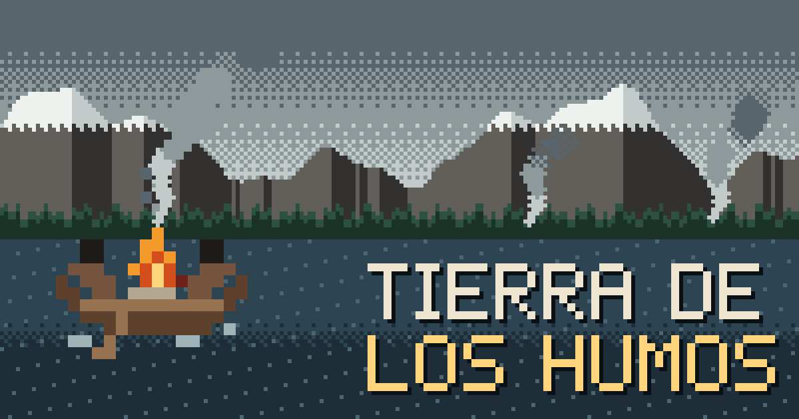
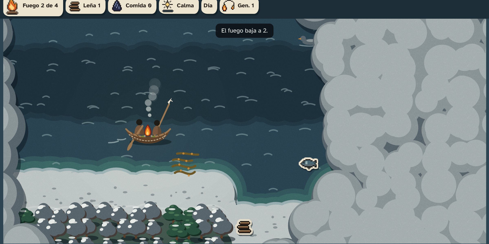

# Primer avance documentado · 14/11/2026

> **Borrador** preparado por la Persona D el 12/11 y puesto al día el 13/11 con lo que hay en el repositorio. Cada persona revisa su parte y completa lo marcado con ✏️ el 14/11 antes de entregar. Lo que no esté hecho se dice tal cual: mostrar el estado real suma más que inflarlo.

**Equipo:** Tierra de los Humos · **Eje:** 04, Memoria, Cultura e Innovación Comunitaria
**Repositorio:** [github.com/Facunique/Tierra-de-los-Humos](https://github.com/Facunique/Tierra-de-los-Humos) · **En línea:** [facunique.github.io/Tierra-de-los-Humos](https://facunique.github.io/Tierra-de-los-Humos/)

## 1. Qué estamos haciendo

Un roguelike web por turnos sobre los saberes de los pueblos fueguinos. Cada partida es un viaje en canoa por los canales acompañando a una familia **Yagán**. El fuego es la vida: el clima lo gasta y el territorio lo sostiene. Si se apaga, lo aprendido pasa a la siguiente generación como **cartas de saber con fuente citada**.

## 2. Qué hicimos esta semana

### Diseño y documentación
- Concepto del juego ([`docs/01-concepto.md`](../docs/01-concepto.md)) y guía de la hackatón ([`docs/00-guia-hackathon.md`](../docs/00-guia-hackathon.md)).
- Memoria de decisiones del equipo ([`equipo/memory.md`](memory.md)) y reparto de tareas con cronograma ([`equipo/tareas.md`](tareas.md)).
- ✏️ Alcance del MVP (`docs/02-alcance-mvp.md`): todavía no está escrito.

### Consulta y contenido cultural (Persona C)
- **Entrevista realizada el 13/11/2026 a las 11:00**, en el Museo del Fin del Mundo, Ushuaia, con **Víctor Vargas Filgueira, referente de la comunidad yagán**. Dani confirmó la fecha, el lugar y el permiso libre para nombrarlo y atribuirle su testimonio como fuente, conforme a sus palabras. Las citas textuales siguen pendientes de permiso específico. Registro: [`comunicaciones.md`](comunicaciones.md#historial).
- **Síntesis de la entrevista registrada:** navegación, fuego, indumentaria, herramientas y organización. 🔍 Las cifras, medidas, detalles técnicos y grafías siguen pendientes de cotejo con la grabación. Se registraron diferencias de vocabulario y de descripción de ceremonias, sin incorporarlas al juego. La consulta no se presenta como validación comunitaria ni como permiso para representar una familia.
- **Revisión documental aportada por Dani:** Vargas Filgueira, Víctor (2019), *Mi sangre yagán (ahua saapa yagan)*, primera edición digital, Editora Cultural Tierra del Fuego. Las páginas del visor del PDF de 90 páginas aportan distintos motivos de desplazamiento: ballena varada (pp. 16–17), corteza conservada para reparar una canoa (pp. 31–32; estacionalidad, p. 23) y reservas de grasa para el invierno (pp. 53–54). **Dani decidió el nomadismo como enfoque del viaje**, con motivos que combinan clima, comida y ambiente. Los objetivos y el cierre de partida quedan pendientes con A y B. 🔍 Faltan las páginas de los agradecimientos y el epílogo sobre el vínculo del autor con Paiakoala.
- **9 cartas de saber en borrador** ([`datos/saberes.js`](../datos/saberes.js)), con referencias a Cooper (1946), «The Yahgan», *Handbook of South American Indians*. Cada carta separa el dato del recurso de juego y tiene texto alternativo. **Ninguna pasó a «revisado» en esta revisión.** No se modificaron textos ni números del juego al registrar la consulta. Está detectada la promesa de reparar la canoa en la carta de corteza, que requiere corrección porque esa acción no existe en el juego.

### Programación (Personas A y B)
- **Stack decidido:** HTML, CSS y JavaScript sin build, con Canvas 2D y sin librerías externas. Abre con doble clic y sin internet, pesa poco para el celular y reusa el motor de dibujo y el sonido que ya estaban ([`memory.md`](memory.md#decisiones)).
- **Publicado en GitHub Pages** desde `main`: el juego entero, que también abre con doble clic y sin internet.
- **Núcleo del juego** (Persona A, [PR 10](https://github.com/Facunique/Tierra-de-los-Humos/pull/10), ya en `main`): las reglas de un viaje de punta a punta.
  - Mapa al azar en cada partida, con humo sobre lo no explorado.
  - Fuego, leña, comida, pirita, clima, día y noche, y acampar en el cachiyuyo.
  - Cartas de saber, victoria y derrota, y herencia entre generaciones.
  - Los datos del territorio están aparte del código, cada uno con su fuente.
  - 49 pruebas automáticas. Un jugador automático que junta y acampa llega al destino el 84 % de las veces; uno que no junta nada no llega nunca.
- **Interfaz** (Persona B): el núcleo ya está conectado en el `index.html` publicado. Se juega de punta a punta, con varias generaciones seguidas.
  - Pantallas de título, elegir pueblo, viaje, fin o llegada, códice, «Hoy» y cómo se juega.
  - Carta de saber con la fuente siempre visible y lectura en voz alta.
  - La herencia queda guardada en el dispositivo: al volver, la familia sigue en su generación.
  - Códice separado por pueblo y postal del viaje.
  - En el celular, se rema tocando el agua o con flechas en pantalla; en la compu, con el teclado.
  - Accesibilidad: alto contraste, textos alternativos, subtítulos del sonido y narrador para jugar sin ver.
  - Probado a 375 px, con el celular acostado y en la compu. Pruebas automáticas de la herencia y de la página: con las del resto del equipo, pasan las 87.

### Arte y sonido (Persona D)
- **Dirección de arte con investigación del territorio** ([`docs/04-direccion-de-arte.md`](../docs/04-direccion-de-arte.md)): qué se ve en los canales (guindo, lenga, turbales, playas de canto rodado, fauna) y qué sabemos de la vida yagán que el arte necesita (la canoa de corteza, el fuego en el centro, la choza, los conchales), con fuentes.
- **Tres propuestas de estilo** sobre la misma escena ([`arte/propuestas/index.html`](../arte/propuestas/index.html)). El equipo eligió **Corteza**: paisaje de papel recortado, con lo que se junta en pixel art.
- **Motor de dibujo Corteza listo para el juego** ([`arte/corteza/`](../arte/corteza/index.html)): luz del fuego en anillos, humo sobre lo no explorado, estaciones, clima, cámara para celular, cartas de saber y códice.
- **Auditoría histórica del arte** ([`docs/05-rigor-historico.md`](../docs/05-rigor-historico.md)): cada elemento dibujado, contrastado con el *Handbook of South American Indians* (Cooper, 1946), con página. Se corrigieron la canoa (costuras, fogón y lugares de cada persona) y las chozas (con la puerta hacia el mar), y se sumaron los hongos de árbol y la pirita.
- **Paleta de 42 colores** del paisaje de los canales, con contraste AAA en el texto principal y AA como mínimo en etiquetas y notas.
- **48 sprites propios** (terreno, canoa con fuego animado, choza, conchal, fauna, fuego del HUD en 5 niveles, íconos) en cuatro estaciones, con su atlas para el motor.
- **Sonido ambiente generado por código** (viento, mar, lluvia, fuego) y efectos, con subtítulos para accesibilidad. Cambia según el lugar: el bosque, la playa y el canal abierto suenan distinto. Sin archivos de audio ni licencias de terceros.
- **Luz real de Ushuaia:** el juego calcula, sin internet, dónde está el sol en el canal Beagle y empieza con esa luz y esa estación.
- **Accesibilidad y difusión:** cartas leídas en voz alta, modo alto contraste, postal del viaje para compartir, versión de mesa para imprimir ([`mesa/`](../mesa/README.md)) y guía para docentes con una actividad por carta ([`escuelas/`](../escuelas/README.md)).
- Logo, ícono y tipografía para baja visión (Atkinson Hyperlegible, licencia OFL), incluida para que funcione sin internet.

## 3. Decisiones importantes

| Decisión | Por qué |
|---|---|
| Yagán primero; Kawésqar si llegamos; Selk'nam a futuro; Haush no. | Profundidad antes que cantidad, y documentación disponible. |
| Personajes sin nombres propios y como siluetas, hasta consultar a la comunidad. | Respeto: no usar nombres ni representar personas sin permiso. |
| Los peligros son el clima y el territorio. Sin violencia ni seres ceremoniales. | Líneas rojas del eje y de las bases. |
| Sin música inventada: el sonido es el territorio y el fuego. | Los cantos son patrimonio de la comunidad. |
| Stack: JavaScript sin build, en GitHub Pages. | Anda con doble clic y sin internet, sin configurar nada, y reusa lo que ya existía. |
| Los datos del territorio y de las cartas van aparte del código. | Así la investigación corrige contenido sin programar. |
| Víctor Vargas Filgueira autorizó que se lo nombre y se lo cite como fuente conforme a sus palabras. | Permiso libre confirmado por Dani; citas textuales y validación comunitaria siguen pendientes. |
| Estilo visual: Corteza (papel recortado y pegatinas pixel). | Más sereno, cuenta mejor el territorio, y se lee bien en el celular. |
| Todo lo dibujado tiene que coincidir con las fuentes etnográficas. | Rigor (20 puntos) y respeto: auditoría en `docs/05`. |

## 4. Uso de inteligencia artificial

Declarado en el README (cláusula 7.4), con una entrada por aporte: qué hizo la IA, a pedido de quién y quién decidió. ✏️ Revisar que esté al día el 14/11.

## 5. Próximos pasos (15 al 17/11)

- **Programación:** conectar el núcleo con la interfaz; herencia guardada en el navegador; códice; pulido y balance jugando con personas; versión sin internet para la demo. ✏️ A y B confirman.
- **Contenido (C):** aportar las fuentes de cada motivo de desplazamiento para acordar con A y B cómo se juega el nomadismo; cotejar la grabación y resolver las consultas pendientes; revisar las nueve cartas, el territorio y las actividades docentes; documentar fuentes escritas y consulta por separado; proponer el cierre del códice y realizar la revisión cultural final. Las aprobaciones de las cartas siguen pendientes.
- **Arte y sonido:** ajustar el arte con lo que diga la comunidad; integrar el sonido según el lugar en el juego; resolver las tres fuentes pendientes del territorio (leña, conchales y tonina); cotejo con el libro de Goodall.
- **Comunicación:** README completo con capturas del juego real, video de 3 minutos (16/11) y pitch de 5 minutos con ensayo.

## 6. Dificultades y pedidos a la mentoría

- **Consulta abierta:** faltan respuestas sobre representación de la familia, nombres, exclusiones y revisión del juego; también el permiso específico para citas textuales y el alcance de la participación comunitaria. 🔍 Todavía no se registró un pedido concreto de ayuda a la mentoría por parte de C.
- **Cómo se juega el nomadismo:** el enfoque decidido por Dani combina clima, comida y ambiente. Falta acordar con A y B los objetivos concretos y el cierre de la partida; la ballena varada permanece como un motivo posible. El prototipo todavía termina al llegar a un destino fijo.
- ✏️ Dudas técnicas de A y B.
