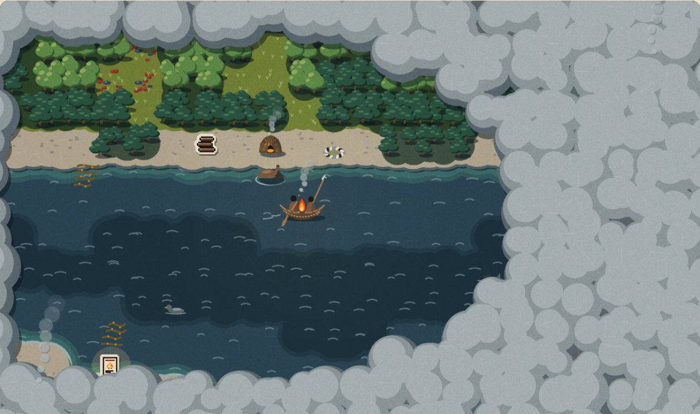

# Primer avance documentado · 14/11/2026

> **Borrador** preparado por la Persona D el 12/11. Cada persona completa lo marcado con ✏️ el 14/11 antes de entregar. Lo que no esté hecho se dice tal cual: mostrar el estado real suma más que inflarlo.

**Equipo:** Tierra de los Humos · **Eje:** 04, Memoria, Cultura e Innovación Comunitaria
**Repositorio:** ✏️ enlace · **Prototipo en línea:** ✏️ enlace de GitHub Pages

## 1. Qué estamos haciendo

Un roguelike web por turnos sobre los saberes de los pueblos fueguinos. Cada partida es un viaje en canoa por los canales acompañando a una familia **Yagán**. El fuego es la vida: el clima lo gasta y el territorio lo sostiene. Si se apaga, lo aprendido pasa a la siguiente generación como **cartas de saber con fuente citada**.

## 2. Qué hicimos esta semana

### Diseño y documentación
- Concepto del juego ([`docs/01-concepto.md`](../docs/01-concepto.md)) y guía de la hackatón ([`docs/00-guia-hackathon.md`](../docs/00-guia-hackathon.md)).
- Memoria de decisiones del equipo ([`equipo/memory.md`](memory.md)).
- ✏️ Alcance del MVP (`docs/02-alcance-mvp.md`).

### Consulta y contenido cultural (Persona C)
- ✏️ Con quién nos contactamos y cuándo (sin datos personales). Estado de cada contacto.
- ✏️ Qué nos respondieron y qué cambiamos por eso.
- ✏️ Cuántas cartas de saber hay escritas y verificadas, y con qué fuentes.

### Programación (Personas A y B)
- ✏️ Stack elegido y por qué.
- ✏️ Qué se puede jugar hoy: mapa, turnos, fuego, recursos, victoria y derrota, carta de saber.
- ✏️ Deploy en GitHub Pages.
- ✏️ Captura o GIF del prototipo.

### Arte y sonido (Persona D)
- **Dirección de arte con investigación del territorio** ([`docs/04-direccion-de-arte.md`](../docs/04-direccion-de-arte.md)): qué se ve en los canales (guindo, lenga, turbales, playas de canto rodado, fauna) y qué sabemos de la vida yagán que el arte necesita (la canoa de corteza, el fuego en el centro, la choza, los conchales), con fuentes.
- **Tres propuestas de estilo** sobre la misma escena ([`arte/propuestas/index.html`](../arte/propuestas/index.html)). El equipo eligió **Corteza**: paisaje de papel recortado, con lo que se junta en pixel art.
- **Motor de dibujo Corteza listo para el juego** ([`arte/corteza/`](../arte/corteza/index.html)): luz del fuego en anillos, humo sobre lo no explorado, estaciones, clima, cámara para celular, cartas de saber y códice.
- **Auditoría histórica del arte** ([`docs/05-rigor-historico.md`](../docs/05-rigor-historico.md)): cada elemento dibujado, contrastado con el *Handbook of South American Indians* (Cooper, 1946), con página. Se corrigieron la canoa (costuras, fogón y lugares de cada persona) y las chozas (con la puerta hacia el mar), y se sumaron los hongos de árbol y la pirita.
- **Paleta de 42 colores** del paisaje de los canales, con contraste AAA en todos los textos.
- **48 sprites propios** (terreno, canoa con fuego animado, choza, conchal, fauna, fuego del HUD en 5 niveles, íconos) en cuatro estaciones, con su atlas para el motor.
- **Sonido ambiente generado por código** (viento, mar, lluvia, fuego) y efectos, con subtítulos para accesibilidad. Cambia según el lugar: el bosque, la playa y el canal abierto suenan distinto. Sin archivos de audio ni licencias de terceros.
- **Luz real de Ushuaia:** el juego calcula, sin internet, dónde está el sol en el canal Beagle y empieza con esa luz y esa estación.
- **Accesibilidad y difusión:** cartas leídas en voz alta, modo alto contraste, postal del viaje para compartir, versión de mesa para imprimir ([`mesa/`](../mesa/README.md)) y guía para docentes con una actividad por carta ([`escuelas/`](../escuelas/README.md)).
- Logo, ícono y tipografía para baja visión (Atkinson Hyperlegible, licencia OFL), incluida para que funcione sin internet.

## 3. Decisiones importantes

| Decisión | Por qué |
|---|---|
| Yagán primero; Kawésqar si llegamos; Selk'nam a futuro; Haush no. | Profundidad antes que cantidad, y documentación disponible. |
| Personajes sin nombres propios y como siluetas, hasta consultar a la comunidad. | Respeto: no usar nombres ni representar personas sin permiso. |
| Los peligros son el clima y el territorio. Sin violencia ni seres ceremoniales. | Líneas rojas del eje y de las bases. |
| Sin música inventada: el sonido es el territorio y el fuego. | Los cantos son patrimonio de la comunidad. |
| ✏️ Stack. | ✏️ |
| Estilo visual: Corteza (papel recortado y pegatinas pixel). | Más sereno, cuenta mejor el territorio, y se lee bien en el celular. |
| Todo lo dibujado tiene que coincidir con las fuentes etnográficas. | Rigor (20 puntos) y respeto: auditoría en `docs/05`. |

## 4. Uso de inteligencia artificial

Declarado en el README (cláusula 7.4). ✏️ Revisar que esté al día.

## 5. Próximos pasos (15 al 17/11)

- ✏️ Programación: pulido, balance, códice, versión sin internet.
- ✏️ Contenido: cartas restantes, revisión cultural final.
- Arte y sonido: ilustraciones de las cartas, arte del destino del viaje (por ejemplo, la ballena varada), integración del motor Corteza y del sonido, cotejo con el libro de Goodall.
- Comunicación: README completo, video de 3 minutos, pitch de 5 minutos con ensayo.

## 6. Dificultades y pedidos a la mentoría

- ✏️ Por ejemplo: si la comunidad no respondió, pedir ayuda para el contacto o alternativas (museo, CADIC).
- ✏️ Dudas técnicas.
