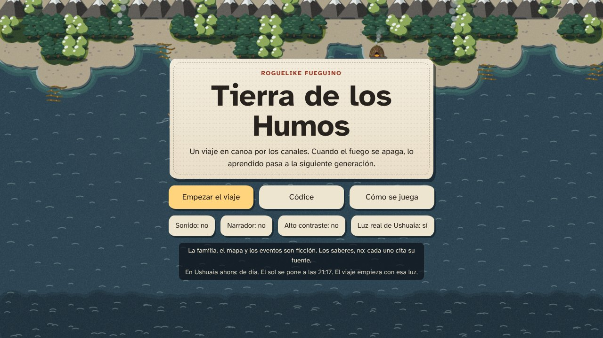
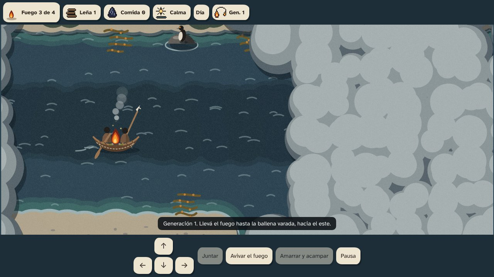
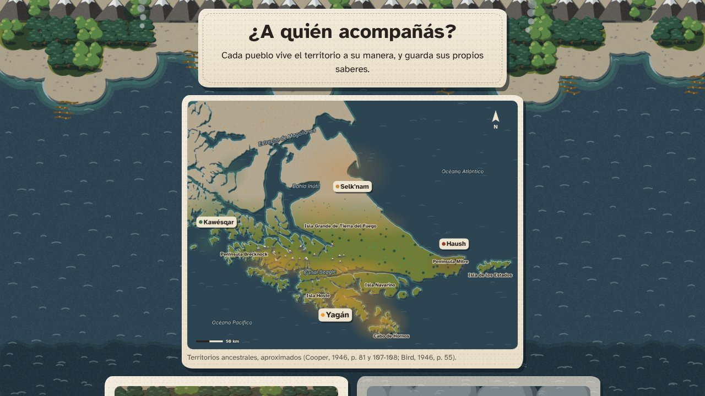
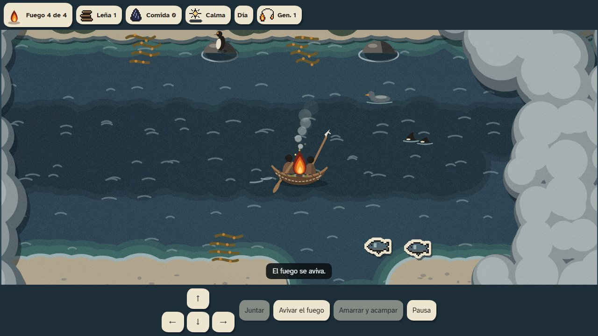
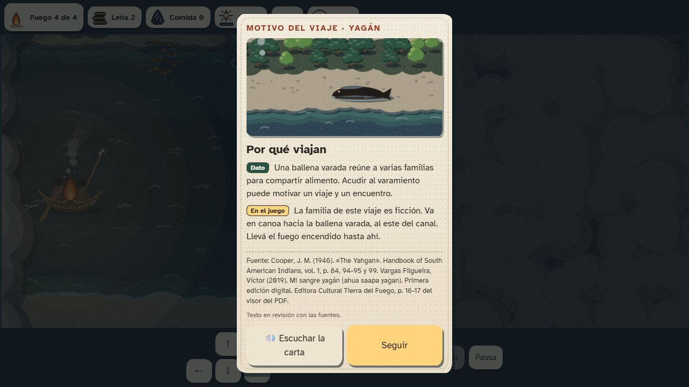
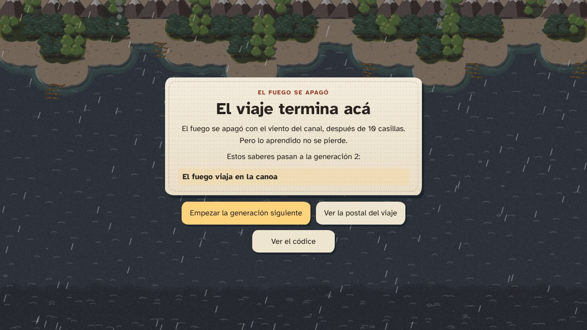
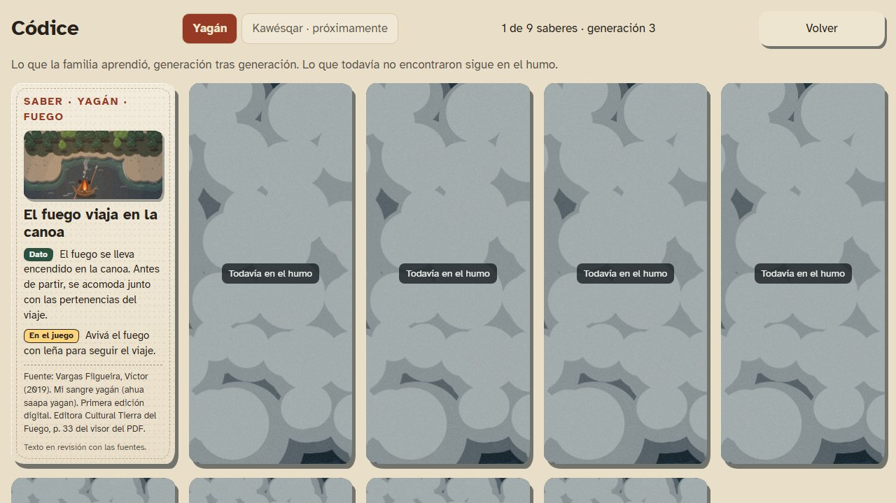
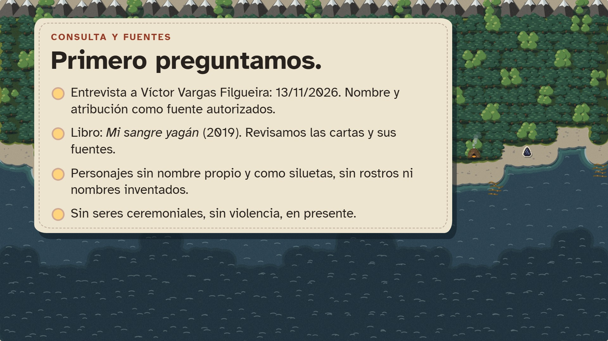
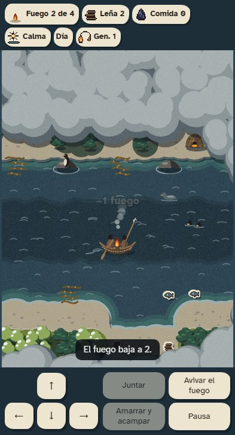
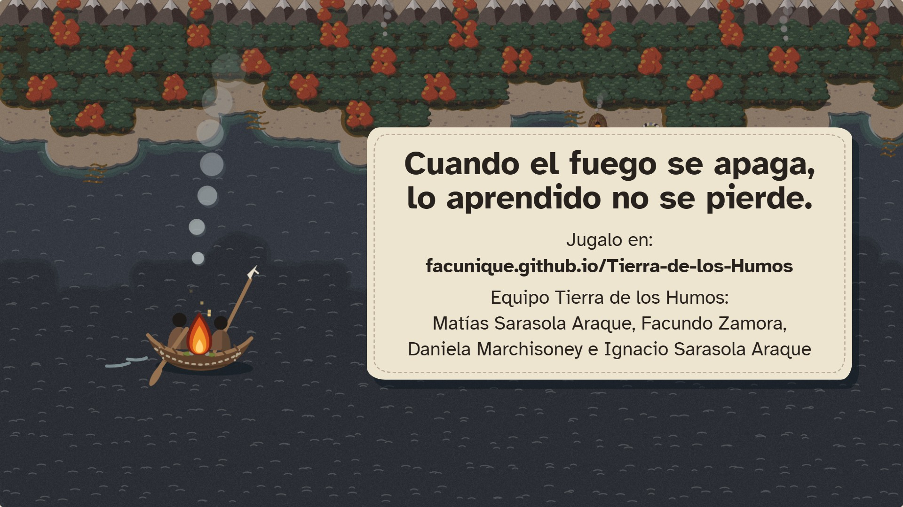

# Storyboard del video (máximo 3:00)

> Persona D. Versión 2 (14/11/2026): las voces siguen la revisión cultural de la Persona C (auditoría del paso 5) y el pitch. Guion completo y consejos de grabación en [`../comunicacion.md`](../comunicacion.md).
> Los cuadros salen de la **maqueta de pantallas** (`arte/pantallas/`), de la vitrina del estilo y de la presentación. El 17/11 se reemplazan por tomas del juego real, con la misma composición.
> 🔍 La Persona C revisa cada frase de la voz antes de grabar.

**Formato:** 1920 × 1080, 30 cuadros por segundo, subtítulos dentro de la imagen. **Sonido:** la voz del equipo y el sonido del propio juego (`sonido/`), sin música de terceros.

| # | Tiempo | Cuadro | Qué se ve | Voz | Sonido |
|---|---|---|---|---|---|
| 1 | 0:00 a 0:12 |  | Pantalla de título con la costa de papel y el humo. La cámara queda quieta. | «Cada partida acompaña a una familia ficticia por los canales fueguinos. El fuego sostiene el viaje y las cartas guardan lo aprendido.» | Viento suave y mar. |
| 2 | 0:12 a 0:25 |  | El mapa con humo; la canoa rema y el humo se abre a su paso. | «Los pueblos fueguinos siguen acá. Este juego acerca fuentes sobre sus saberes a jóvenes y escuelas, en presente.» | Remo, crepitar del fuego. |
| 3 | 0:25 a 0:40 |  | Pantalla de inicio del juego. | «Tierra de los Humos es un juego web por turnos. Cada partida es un viaje en canoa por los canales, acompañando a una familia yagán ficticia.» | Golpe de madera al elegir. |
| 4 | 0:40 a 1:15 |  | Partida: remar, se levanta viento, el fuego del HUD baja, juntar leña, avivar el fuego, amarrar en el cachiyuyo. | «El fuego es tu vida. El viento, la lluvia y la noche lo gastan; la leña y el amarre en el cachiyuyo lo sostienen.» | Viento fuerte, remo, leña al fuego. Al pasar junto al bosque, las hojas; en la playa, la resaca con piedritas. |
| 5 | 1:15 a 1:40 |  | Aparece una carta. Acercamiento a «Dato», «En el juego» y la fuente con página. | «En el viaje aparecen saberes. Cada carta separa lo que es dato de lo que es recurso de juego, y cita su fuente.» | Sonido de saber. |
| 6 | 1:40 a 2:05 |  | El fuego se apaga. Fundido. Pantalla de fin del viaje con los saberes heredados; empieza la generación 2. | «Si el fuego se apaga, el viaje termina. Lo aprendido se transmite: pasa a la siguiente generación.» | Fuego que se apaga; acorde de nueva generación. |
| 7 | 2:05 a 2:25 |  | Recorrido por el códice: cartas encontradas y cartas todavía en el humo. | «Todas las cartas se juntan en un códice que se puede recorrer sin jugar. Para las escuelas hay una guía para docentes, una versión de mesa sin pantallas y un editor para sumar saberes.» | Mar suave. |
| 8 | 2:25 a 2:45 |  | El equipo trabajando: la revisión de las cartas y sus fuentes. De la entrevista no se muestran imágenes ni citas textuales: el permiso registrado es para nombrar a Víctor y atribuirle el testimonio. Si no hay imágenes, esta diapositiva. | «Consultamos a Víctor Vargas Filgueira, referente de la comunidad yagán y autor de Mi sangre yagán. Revisamos las cartas con sus fuentes, y la consulta sigue abierta.» | Mar suave. |
| 9 | 2:45 a 3:00 |   | El juego en un celular, en la mano. Después, la frase final, el enlace y los nombres. | «Se juega desde el navegador, también en el celular. Las fuentes y la consulta están en el repositorio. Lo aprendido se transmite.» | Fuego vivo y viento suave, que se apaga al final. |

## Cómo grabarlo

**Los clips del juego ya se pueden grabar solos:**

```bash
node equipo/video/grabar.cjs
```

El script juega y graba un clip por cuadro en `equipo/video/clips/`, en 1920 × 1080: título, humo, viaje con carta, fin y herencia, códice, y el juego en un celular. También escribe `subtitulos.srt` con la voz de la tabla de arriba y arma `clips/juego.gif` para el README. Los clips no se suben al repositorio porque pesan mucho. El 16/11, con el juego conectado, alcanza con volver a correrlo. Lo que sigue a mano: las voces, la toma del celular en la mano y el montaje.


1. **Pantalla:** OBS Studio, 1920 × 1080. Abrir el juego en pantalla completa y activar el sonido.
2. **Celular (cuadro 9):** la grabación de pantalla del teléfono, más una toma del celular en la mano.
3. **Voz:** una persona por tramo, en un lugar sin eco. Grabar cada frase dos veces.
4. **Edición:** Shotcut o DaVinci Resolve. Los subtítulos son el mismo texto de la voz, en Atkinson Hyperlegible, blanco con sombra.
5. **Antes de exportar:** controlar que dure 3:00 o menos, que se lea cada fuente y que no aparezca ningún dato personal.
6. **Exportar:** MP4 (H.264). Subirlo como «no listado» donde indique la organización y poner el enlace en el README.

## Si el juego no está listo a tiempo

Se puede grabar todo con la maqueta (`arte/pantallas/index.html`): tiene el recorrido completo y un bucle de prueba. En ese caso, decir en la voz o en un cartel que es un prototipo de interfaz.
